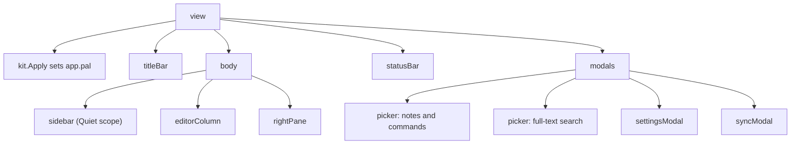

# Apply nota-kit to Nota Implementation Plan

> **For agentic workers:** REQUIRED SUB-SKILL: Use superpowers:subagent-driven-development (recommended) or superpowers:executing-plans to implement this plan task-by-task. Steps use checkbox (`- [ ]`) syntax for tracking.

**Goal:** The real Nota window looks like the approved `cmd/nota-kit` preview, with every existing feature still wired up.

**Architecture:** Each view function in `cmd/nota` is replaced by its approved twin from `cmd/nota-kit`. The mock data is swapped for real `App` state and handlers (`app.run`, `app.openNote`, `app.index`). `kit.Apply` replaces `applyTheme` and `theme.go`. One `picker` serves both the merged quick-open/command palette and full-text search. `ui.Split` and `ui.SplitPercent` stay, so pane sizes still persist.

**Tech Stack:** Go 1.27.3, MyGo v0.7.1 (`ui`, `ui/editor`, `ui/markdown`), `nota/internal/kit`, headless `ui.NewTester`.



## Global Constraints

- No new dependencies. Do not change `internal/settings`, `internal/keymap`, `internal/index` or any file format (settings JSON, `keybindings.json`, session, index).
- Every command id in `commands()` and `run()` and every keybinding keeps working. Ctrl+O and Ctrl+P both open the merged palette.
- Keep `ui.Split` and `ui.SplitPercent`, plus the persisted `sidebarW`, `editorPct`, `showSide`, `showRight`, `rightTab` and `mode`.
- Take colors from `app.pal` / `c.Theme()` only. Add no hex literals to `cmd/nota`.
- The settings value `"slate"` still loads and now follows the system, because `kit.Pick` treats unknown modes that way.
- Shell setup: `export PATH="/c/Program Files/Go/bin:$PATH"` before any `go` command.
- Commits follow Conventional Commits 1.0.0.
- Graft: use `graft callers <sym>` before deleting any symbol, and run `graft build` at the end.

---

### Task 1: Truthful shortcut hints

**Files:**
- Modify: [internal/kit/parts.go](internal/kit/parts.go) L121-136 (`SearchTrigger`)
- Modify: [cmd/nota-kit/workspace.go](cmd/nota-kit/workspace.go) L164, [cmd/nota-kit/screens.go](cmd/nota-kit/screens.go) L79
- Modify: [cmd/nota/keys.go](cmd/nota/keys.go)
- Create: `cmd/nota/keys_test.go`

**Interfaces:**
- Produces: `kit.SearchTrigger(c *ui.Context, placeholder string, keys ...string) ui.Element` (shows a `Kbd` only when `keys` is non-empty), and `(app *App) keyLabel(command string) []string`.

- [ ] **Step 1: Write the failing test** `cmd/nota/keys_test.go`

```go
package main

import (
	"slices"
	"testing"

	"nota/internal/keymap"
	"nota/internal/kit"
)

func TestKeyLabel(t *testing.T) {
	app := &App{bindings: keymap.Default()}
	for cmd, want := range map[string][]string{
		"quickOpen": {kit.Mod(), "O"},
		"search":    {kit.Mod(), "Shift", "F"},
		"unbound":   nil,
	} {
		if got := app.keyLabel(cmd); !slices.Equal(got, want) {
			t.Errorf("keyLabel(%q) = %q, want %q", cmd, got, want)
		}
	}
}
```

- [ ] **Step 2:** Run `go test ./cmd/nota -run TestKeyLabel`. Expected: FAIL to compile, `app.keyLabel undefined`.
- [ ] **Step 3: Implement.** Append to `cmd/nota/keys.go`, adding imports `strings` and `nota/internal/kit`:

```go
// keyLabel is the first chord bound to command, as kit.Kbd keys, or nil.
func (app *App) keyLabel(command string) []string {
	for _, b := range app.bindings {
		ch, ok := keymap.ParseChord(b.Key)
		if b.Command != command || !ok {
			continue
		}
		var keys []string
		if ch.Ctrl || ch.Super { // one key to chordMods
			keys = append(keys, kit.Mod())
		}
		if ch.Shift {
			keys = append(keys, "Shift")
		}
		if ch.Alt {
			keys = append(keys, "Alt")
		}
		return append(keys, strings.ToUpper(ch.Key))
	}
	return nil
}
```

  In `internal/kit/parts.go`, change the signature and doc to "an icon, placeholder text and, unless keys is empty, the shortcut", then replace `Kbd(c, Mod(), "K")` with:

```go
		if len(keys) > 0 {
			Kbd(c, keys...)
		}
```

  Update both preview callers to pass `kit.Mod(), "K"`. For example, `kit.SearchTrigger(c, "Search notes or run a command", kit.Mod(), "K")`.
- [ ] **Step 4:** Run `go test ./cmd/nota ./cmd/nota-kit ./internal/kit`. Expected: PASS.
- [ ] **Step 5: Commit** (two commits)

```bash
git add internal/kit/parts.go cmd/nota-kit && git commit -m "feat(kit): take the shortcut keys in SearchTrigger"
git add cmd/nota/keys.go cmd/nota/keys_test.go && git commit -m "feat(nota): label shortcuts from the keymap"
```

---

### Task 2: Theme, title bar, status bar, welcome

**Files:**
- Modify: [cmd/nota/view.go](cmd/nota/view.go) L13-140. Rewrite `view`, delete `applyTheme`, rewrite `welcome`, replace `toolbar` with `titleBar` and `breadcrumb`, replace `footer` with `statusBar`, and delete `modeLabel` at L353-362.
- Delete: [cmd/nota/theme.go](cmd/nota/theme.go). Graft shows `slateTheme`'s only caller is `applyTheme`.
- Modify: [cmd/nota/app.go](cmd/nota/app.go). Add an `App` field, and delete L301 `app.status = plural(app.index.Count(), "note")` in `catchUp`, because the status bar now always shows the count.
- Create: `cmd/nota/view_test.go`

**Interfaces:**
- Consumes: `app.keyLabel` (Task 1).
- Produces: `App.pal kit.Palette` (set first in every frame), plus the test helpers `isolate(t)`, `testApp(t) *App` and `const width, height = 1280, 820`.

- [ ] **Step 1: Write the failing tests** `cmd/nota/view_test.go`

```go
package main

import (
	"os"
	"path/filepath"
	"testing"
	"time"

	"github.com/egoist/mygo/ui"
)

const width, height = 1280, 820

// isolate points the config dir at a temp dir, so tests leave the real
// settings and keybindings alone.
func isolate(t *testing.T) {
	t.Helper()
	cfg := t.TempDir()
	t.Setenv("AppData", cfg)         // Windows
	t.Setenv("XDG_CONFIG_HOME", cfg) // Linux
	t.Setenv("HOME", cfg)            // macOS
}

// testApp opens a two-note vault with Roadmap.md in a tab.
func testApp(t *testing.T) *App {
	t.Helper()
	isolate(t)
	dir := t.TempDir()
	notes := map[string]string{
		"Roadmap.md": "# Roadmap\n\nShip the kit. See [[Ideas]].\n",
		"Ideas.md":   "# Ideas\n\nSome #project notes.\n",
	}
	for name, body := range notes {
		if err := os.WriteFile(filepath.Join(dir, name), []byte(body), 0o644); err != nil {
			t.Fatal(err)
		}
	}
	app := newApp()
	app.openVault(dir)
	if app.vault == nil || app.watchCancel == nil {
		t.Fatalf("open vault: %s", app.status)
	}
	t.Cleanup(app.watchCancel)
	// catchUp saves the index last; once it exists the notes are indexed
	// and nothing writes into dir.
	gob := filepath.Join(dir, ".app", "index.gob")
	for i := 0; i < 500; i++ {
		if _, err := os.Stat(gob); err == nil {
			break
		}
		time.Sleep(10 * time.Millisecond)
	}
	app.openNote("Roadmap.md")
	return app
}

func TestWelcomeWithoutVault(t *testing.T) {
	isolate(t)
	tt := ui.NewTester(newApp().view, width, height)
	if !tt.HasText("Welcome to Nota") {
		t.Errorf("welcome shows %q", tt.Texts())
	}
}

func TestWorkspaceShowsKit(t *testing.T) {
	app := testApp(t)
	tt := ui.NewTester(app.view, width, height)
	for _, s := range []string{"Search notes or run a command", "2 notes", "AI offline"} {
		if !tt.HasText(s) {
			t.Errorf("no %q in %q", s, tt.Texts())
		}
	}
}
```

- [ ] **Step 2:** Run `go test ./cmd/nota -run "Welcome|WorkspaceShowsKit"`. Expected: FAIL, no "Welcome to Nota" and no "Search notes or run a command".
- [ ] **Step 3: Implement.**

  In `app.go`, add the import `nota/internal/kit` and, after `mdOpts`, the field `pal kit.Palette // this frame's colors, set first in view`.

  In `view.go`, add the import `nota/internal/kit` and replace L13-109 and L126-140 (keep `body` L111-124 as is):

```go
func (app *App) view(c *ui.Context) {
	app.pal = kit.Apply(c, app.settings.Theme, app.settings.FontSize)
	if th := app.mdOpts.Theme; th != nil {
		th.LineHeight = 1.65
		th.Link, th.Muted, th.CodeBackground = app.pal.Link, c.Theme().TextMuted, app.pal.Muted
		if app.settings.FontSize > 0 {
			th.FontSize = app.settings.FontSize
		}
	}
	app.shortcuts(c)
	if app.vault == nil {
		app.welcome(c)
		app.modals(c)
		return
	}
	if t := app.current(); t != nil {
		app.autosave(t)
		app.caretLine.Store(int32(t.state.CursorPos().Line))
		t.state.SoftWrap = app.settings.SoftWrap
		if app.settings.FontSize > 0 {
			t.state.Font.Size = app.settings.FontSize
		}
	}
	app.graphFG = c.Theme().TextMuted
	app.graphAC = app.pal.Link
	app.graphTX = c.Theme().Text
	ui.Column(c).Fill().Background(c.Theme().Background).Children(func() {
		app.titleBar(c)
		app.body(c)
		app.statusBar(c)
	})
	app.modals(c)
}

func (app *App) welcome(c *ui.Context) {
	t := c.Theme()
	ui.Column(c).Fill().Center().Children(func() {
		ui.Column(c).Width(420).Gap(24).Children(func() {
			ui.Column(c).Gap(14).Children(func() {
				ui.Row(c).Size(40, 40).Radius(10).Background(app.pal.Primary).Justify(ui.Center).AlignItems(ui.Center).Children(func() {
					ui.Text(c, "N").FontSize(20).FontWeight(700).TextColor(app.pal.PrimaryForeground)
				})
				ui.Column(c).Gap(4).Children(func() {
					ui.Text(c, "Welcome to Nota").FontSize(22).FontWeight(600)
					ui.Text(c, "A small offline vault for Markdown notes.").TextColor(t.TextMuted)
				})
			})
			open := ui.PrimaryButton(c, "").AlignSelf(ui.Start).Height(34).Padding(0, 14).Gap(8).Children(func() {
				ui.Icon(c, kit.IconOpen).FontSize(15)
				ui.Text(c, "Open vault…").SingleLine()
			})
			if open.Clicked() {
				app.pickVault()
			}
			if len(app.settings.Recent) == 0 {
				return
			}
			ui.Column(c).Gap(4).Children(func() {
				kit.SectionLabel(c, "Recent")
				ui.Column(c).Padding(4).Radius(10).Border(1, t.Border).Children(func() {
					for _, dir := range app.settings.Recent {
						if kit.NavRow(c.Key(dir), kit.IconFolder, filepathBase(dir), false, func() {
							ui.Text(c, dir).FontSize(12).TextColor(t.TextMuted).SingleLine().MaxWidth(200)
						}).Height(36).Clicked() {
							app.openVault(dir)
						}
					}
				})
			})
		})
	})
}

func (app *App) titleBar(c *ui.Context) {
	t := c.Theme()
	ui.Row(c).Height(44).Shrink(0).Padding(0, 8).Gap(4).AlignItems(ui.Center).
		BorderWidth(0, 0, 1, 0).BorderColor(t.Border).Children(func() {
		if kit.IconButton(c, kit.IconSidebar, "Toggle file tree", false).Clicked() {
			app.run("toggleSidebar")
		}
		app.breadcrumb(c)
		ui.Spacer(c)
		if kit.SearchTrigger(c, "Search notes or run a command", app.keyLabel("quickOpen")...).Clicked() {
			app.run("quickOpen")
		}
		ui.Spacer(c)
		kit.Tabs(c, &app.mode, []*ui.SVG{kit.IconSource, kit.IconLive, kit.IconRead}, "Source", "Live", "Reading")
		ui.Box(c).Width(4)
		if kit.IconButton(c, kit.IconAI, "Assistant", app.showRight && app.rightTab == 4).Clicked() {
			app.showRight, app.rightTab = true, 4
		}
		if kit.IconButton(c, kit.IconSync, "Sync", false).Clicked() {
			app.run("sync")
		}
		if kit.IconButton(c, kit.IconSettings, "Settings", false).Clicked() {
			app.run("settings")
		}
		if kit.IconButton(c, kit.IconInspector, "Toggle side pane", false).Clicked() {
			app.run("toggleRight")
		}
	})
}

func (app *App) breadcrumb(c *ui.Context) {
	cur := app.current()
	if cur == nil {
		return
	}
	t := c.Theme()
	parts := strings.Split(cur.path, "/")
	ui.Row(c).Gap(6).PaddingX(4).AlignItems(ui.Center).Children(func() {
		for i, part := range parts {
			if i > 0 {
				ui.Text(c, "/").FontSize(t.FontSize - 1).TextColor(t.TextMuted.Alpha(0.6))
			}
			if i == len(parts)-1 {
				ui.Text(c, note.TitleFromName(part)).FontSize(t.FontSize - 1).FontWeight(500).SingleLine()
				continue
			}
			ui.Text(c, part).FontSize(t.FontSize - 1).TextColor(t.TextMuted).SingleLine()
		}
	})
}

func (app *App) statusBar(c *ui.Context) {
	t := c.Theme()
	small := func(s string) { ui.Text(c, s).FontSize(12).TextColor(t.TextMuted).SingleLine() }
	ui.Row(c).Height(28).Shrink(0).Padding(0, 12).Gap(16).AlignItems(ui.Center).
		BorderWidth(1, 0, 0, 0).BorderColor(t.Border).Children(func() {
		if cur := app.current(); cur != nil {
			small(cur.path)
			small(plural(len(strings.Fields(cur.state.Buffer.String())), "word"))
		}
		ui.Spacer(c)
		if app.status != "" {
			small(app.status)
		}
		dot := t.TextMuted
		if app.aiReach == "ready" {
			dot = app.pal.Success
		}
		ui.Row(c).Gap(6).AlignItems(ui.Center).Children(func() {
			kit.Dot(c, dot)
			small("AI " + app.aiReach)
		})
		small(plural(app.index.Count(), "note"))
	})
}
```

  Delete `modeLabel` and `cmd/nota/theme.go`. Re-check with `graft callers modeLabel` and `graft callers slateTheme`, expecting no callers.
- [ ] **Step 4:** Run `go vet ./cmd/nota && go test ./cmd/nota`. Expected: PASS.
- [ ] **Step 5: Commit** `git add -A cmd/nota && git commit -m "feat(nota): adopt the kit theme, title bar and status bar"`

---

### Task 3: One palette for notes and commands

**Files:**
- Modify: [cmd/nota/view.go](cmd/nota/view.go). Change the first lines of `modals` (L143-155), replace `picker` (L186-218), delete `commandPicker` (L220-246), and drop the `nota/internal/index` import.
- Modify: [cmd/nota/app.go](cmd/nota/app.go). Delete the fields `palette`, `paletteQuery`, `paletteList`, `paletteSel` and `searchHits` (L97-103; `searchHits` is unused). Change `run` L469-474 and the `shortcuts` guard at L530.
- Test: `cmd/nota/view_test.go`

**Interfaces:**
- Produces: `type paletteItem struct{ icon *ui.SVG; title, sub string; run func() }`, `(app *App) quickItems(q string) []paletteItem` and `(app *App) searchItems(q string) []paletteItem`.

- [ ] **Step 1: Write the failing test** (append):

```go
func TestPaletteFindsNotesAndCommands(t *testing.T) {
	app := testApp(t)
	tt := ui.NewTester(app.view, width, height)
	tt.Key(ui.Cmd, ui.KeyO)
	tt.Type("ideas")
	tt.Key(0, ui.KeyEnter)
	if app.quickOpen || app.current() == nil || app.current().path != "Ideas.md" {
		t.Fatalf("after Enter on ideas: open %v, texts %q", app.quickOpen, tt.Texts())
	}
	tt.Key(ui.Cmd, ui.KeyO)
	tt.Type("settings")
	tt.Key(0, ui.KeyEnter)
	if !app.settingsOn {
		t.Errorf("Enter on settings did not open Settings; texts %q", tt.Texts())
	}
}
```

- [ ] **Step 2:** Run `go test ./cmd/nota -run Palette`. Expected: FAIL, because the old quick open has no commands and keeps the query "ideas".
- [ ] **Step 3: Implement.** In `app.go`:

```go
	case "quickOpen", "commandPalette":
		app.quickOpen, app.quickQuery, app.quickSel = true, "", 0
```

  Remove `app.palette || ` from the `shortcuts` guard, and delete the five fields listed above. In `view.go`, replace the two `app.picker(...)` calls and `app.commandPicker(c)` at the top of `modals` with:

```go
	app.picker(c, &app.quickOpen, "Search notes or type a command…", &app.quickQuery, &app.quickList, &app.quickSel, app.quickItems)
	app.picker(c, &app.searchOpen, "Search inside notes…", &app.searchQuery, &app.searchList, &app.searchSel, app.searchItems)
```

  Replace `picker` and `commandPicker` with:

```go
type paletteItem struct {
	icon       *ui.SVG
	title, sub string
	run        func()
}

func (app *App) quickItems(q string) []paletteItem {
	var out []paletteItem
	if app.index != nil {
		for _, h := range app.index.Fuzzy(q, 30) {
			out = append(out, paletteItem{kit.IconNote, h.Title, h.Path, func() { app.openNote(h.Path) }})
		}
	}
	for _, cmd := range filterCommands(app.commands(), q) {
		out = append(out, paletteItem{kit.IconCommand, cmd.Title, "Command", func() { app.run(cmd.ID) }})
	}
	return out
}

func (app *App) searchItems(q string) []paletteItem {
	if strings.TrimSpace(q) == "" || app.index == nil {
		return nil
	}
	var out []paletteItem
	for _, h := range app.index.Search(q, 40) {
		sub := h.Path
		if h.Snippet != "" {
			sub = h.Snippet
		}
		out = append(out, paletteItem{kit.IconNote, h.Title, sub, func() { app.openNote(h.Path) }})
	}
	return out
}

// picker is the command palette: a field over items, chosen with the
// arrows and Enter. It closes before it runs the choice.
func (app *App) picker(c *ui.Context, open *bool, placeholder string, query *string, list *ui.ListState, sel *int, items func(string) []paletteItem) {
	kit.Dialog(c, open, 560, func() {
		t := c.Theme()
		its := items(*query)
		if *sel >= len(its) {
			*sel = 0
		}
		if c.Shortcut(0, ui.KeyDown) && *sel < len(its)-1 {
			*sel++
		}
		if c.Shortcut(0, ui.KeyUp) && *sel > 0 {
			*sel--
		}
		choose := func() {
			if *sel >= 0 && *sel < len(its) {
				*open = false
				its[*sel].run()
			}
		}
		ui.Row(c).Height(48).Padding(0, 14).Gap(10).AlignItems(ui.Center).
			BorderWidth(0, 0, 1, 0).BorderColor(t.Border).Children(func() {
			ui.Icon(c, kit.IconSearch).FontSize(16).TextColor(t.TextMuted)
			in := ui.TextInput(c, query).Placeholder(placeholder).AutoFocus().Grow(1).
				Border(0, ui.Transparent).Background(ui.Transparent)
			if in.Submitted() {
				choose()
			}
		})
		if len(its) == 0 {
			kit.EmptyState(c, kit.IconSearch, "No matches", "Try another word.", "")
			return
		}
		quiet := *kit.Quiet(app.pal, t.FontSize)
		quiet.Surface = app.pal.Background
		kit.Scoped(c, &quiet, func() {
			list.Selected = sel
			l := ui.List(c, list, len(its), func(i int) {
				it := its[i]
				ui.Row(c).Gap(10).Padding(0, 6).AlignItems(ui.Center).Children(func() {
					ui.Icon(c, it.icon).FontSize(15).TextColor(quiet.TextMuted)
					ui.Text(c, it.title).SingleLine().Grow(1)
					ui.Text(c, it.sub).FontSize(12).TextColor(quiet.TextMuted).SingleLine().MaxWidth(240)
				})
			}).Height(300).Padding(6)
			if l.Submitted() {
				choose()
			}
		})
		ui.Row(c).Height(36).Padding(0, 14).Gap(14).AlignItems(ui.Center).
			BorderWidth(1, 0, 0, 0).BorderColor(t.Border).Children(func() {
			keyHint := func(label string, keys ...string) {
				ui.Row(c).Gap(6).AlignItems(ui.Center).Children(func() {
					kit.Kbd(c, keys...)
					ui.Text(c, label).FontSize(12).TextColor(t.TextMuted)
				})
			}
			keyHint("navigate", "↑", "↓")
			keyHint("open", "Enter")
			keyHint("close", "Esc")
		})
	})
}
```

  Run `graft grep "app.palette"` and expect no hits.
- [ ] **Step 4:** Run `go vet ./cmd/nota && go test ./cmd/nota`. Expected: PASS.
- [ ] **Step 5: Commit** `git add cmd/nota && git commit -m "feat(nota): merge quick open and commands into one palette"`

---

### Task 4: File tree and side pane

**Files:**
- Modify: [cmd/nota/side.go](cmd/nota/side.go). Replace `sidebar` (L14-53), `rightPane` (L55-71), `linksPane`, `outlinePane` and `tagsPane` (L73-174). In `graphPane`, change the empty state and the box (L182-187). Add `vaultSwitcher`, `initial` and `hint`.
- Test: `cmd/nota/view_test.go`

**Interfaces:**
- Consumes: `app.pal`, `app.keyLabel`. Produces: `hint(c *ui.Context, s string)`.

- [ ] **Step 1: Write the failing test** (append):

```go
func TestSidebarAndSidePane(t *testing.T) {
	app := testApp(t)
	tt := ui.NewTester(app.view, width, height)
	for _, s := range []string{"New note", "Today", "Backlinks", "Outgoing"} {
		if !tt.HasText(s) {
			t.Errorf("no %q in %q", s, tt.Texts())
		}
	}
	if err := tt.Click("Tags"); err != nil {
		t.Fatal(err)
	}
	if !tt.HasText("All tags") || !tt.HasText("project") {
		t.Errorf("tags pane shows %q", tt.Texts())
	}
}
```

- [ ] **Step 2:** Run `go test ./cmd/nota -run SidebarAndSidePane`. Expected: FAIL, no "New note" and no "All tags".
- [ ] **Step 3: Implement.** Add the import `nota/internal/kit`. The `ContextMenu` body and the `fileRow` open logic move over unchanged.

```go
func (app *App) sidebar(c *ui.Context) {
	kit.Scoped(c, kit.Quiet(app.pal, c.Theme().FontSize), func() {
		t := c.Theme()
		ui.Column(c).Fill().Padding(8).Gap(2).Background(t.Surface).Children(func() {
			app.vaultSwitcher(c)
			if kit.NavRow(c, kit.IconPlus, "New note", false, func() { kit.Kbd(c, app.keyLabel("newNote")...) }).Clicked() {
				app.run("newNote")
			}
			if kit.NavRow(c, kit.IconDaily, "Today", false, nil).Clicked() {
				app.run("dailyNote")
			}
			kit.SectionLabel(c, "Files")
			app.outline.List.Selected = &app.fileRow
			ui.Outline(c, &app.outline, app.roots, app.childPaths, func(path string) {
				icon := kit.IconNote
				if app.dirs[path] {
					icon = kit.IconFolder
				}
				row := ui.Row(c).Grow(1).Gap(8).AlignItems(ui.Center)
				row.ContextMenu(func(m *ui.Menu) {
					dir := path
					if !app.dirs[path] {
						dir = parentPath(path)
					}
					if m.Item("New note").Chosen() {
						app.newDir = dir
						app.modalText = ""
						app.creating = true
					}
					if !app.dirs[path] && m.Item("Delete").Chosen() {
						app.openNote(path)
						app.deleting = true
					}
				})
				row.Children(func() {
					ui.Icon(c, icon).FontSize(15).TextColor(t.TextMuted)
					ui.Text(c, note.TitleFromName(path)).SingleLine()
				})
			}).Grow(1)
			if app.fileRow >= 0 && app.fileRow < app.outline.Rows() {
				item := app.outline.Item(app.fileRow)
				if item != app.lastTree && !app.dirs[item] {
					app.lastTree = item
					app.openNote(item)
				}
			}
		})
	})
}

func (app *App) vaultSwitcher(c *ui.Context) {
	t := c.Theme()
	name := filepathBase(app.vault.Root())
	b := ui.ButtonBase(c).AlignSelf(ui.Stretch).Justify(ui.Start).Height(44).Padding(0, 8).Gap(10).Radius(8).
		Tooltip("Open another vault")
	if b.Hovered() {
		b.Background(t.SurfaceHover)
	}
	b.Children(func() {
		ui.Row(c).Size(28, 28).Radius(7).Background(app.pal.Primary).Justify(ui.Center).AlignItems(ui.Center).Children(func() {
			ui.Text(c, initial(name)).FontWeight(700).TextColor(app.pal.PrimaryForeground)
		})
		ui.Column(c).Grow(1).MinWidth(0).Gap(1).Children(func() {
			ui.Text(c, name).FontWeight(600).SingleLine()
			ui.Text(c, plural(app.index.Count(), "note")).FontSize(12).TextColor(t.TextMuted)
		})
		ui.Icon(c, kit.IconChevronDown).FontSize(14).TextColor(t.TextMuted)
	})
	if b.Clicked() {
		app.pickVault()
	}
}

// initial is the vault mark's letter. A drive root has an empty base.
func initial(s string) string {
	for _, r := range s {
		return strings.ToUpper(string(r))
	}
	return "N"
}

func (app *App) rightPane(c *ui.Context) {
	ui.Column(c).Fill().Padding(12).Gap(8).Children(func() {
		kit.Tabs(c, &app.rightTab, []*ui.SVG{kit.IconLink, kit.IconOutline, kit.IconTag, kit.IconGraph, kit.IconAI},
			"Links", "Outline", "Tags", "Graph", "Assistant").AlignSelf(ui.Stretch)
		switch app.rightTab {
		case 0:
			app.linksPane(c)
		case 1:
			app.outlinePane(c)
		case 2:
			app.tagsPane(c)
		case 3:
			app.graphPane(c)
		default:
			app.aiPane(c)
		}
	})
}

func hint(c *ui.Context, s string) {
	ui.Row(c).Padding(4, 8).Children(func() {
		ui.Text(c, s).FontSize(12).TextColor(c.Theme().TextMuted)
	})
}

func (app *App) linksPane(c *ui.Context) {
	t := app.current()
	if t == nil {
		kit.EmptyState(c, kit.IconLink, "No note open", "Links to and from a note show here.", "")
		return
	}
	row := func(group, path, title string) {
		if kit.NavRow(c.Key(group+path), kit.IconNote, title, false, nil).Clicked() {
			app.openNote(path)
		}
	}
	ui.Scroll(c).Grow(1).Children(func() {
		ui.Column(c).Gap(2).Children(func() {
			kit.SectionLabel(c, "Backlinks")
			backs := app.index.Backlinks(t.path)
			if len(backs) == 0 {
				hint(c, "None yet")
			}
			for _, h := range backs {
				row("back:", h.Path, h.Title)
			}
			out, missing := app.index.Outgoing(t.path)
			kit.SectionLabel(c, "Outgoing")
			if len(out) == 0 && len(missing) == 0 {
				hint(c, "None yet")
			}
			for _, h := range out {
				row("out:", h.Path, h.Title)
			}
			for _, name := range missing {
				hint(c, "Unresolved "+name)
			}
			kit.SectionLabel(c, "Related")
			if kit.NavRow(c, kit.IconAI, "Find related", false, nil).Clicked() {
				app.findRelated()
			}
			for _, h := range app.related {
				row("rel:", h.Path, note.TitleFromName(h.Path))
			}
		})
	})
}

func (app *App) outlinePane(c *ui.Context) {
	t := app.current()
	if t == nil {
		kit.EmptyState(c, kit.IconOutline, "No note open", "Headings of the open note show here.", "")
		return
	}
	doc := app.cachedDoc(t)
	if len(doc.Headings) == 0 {
		kit.EmptyState(c, kit.IconOutline, "No headings", "Lines starting with # show here.", "")
		return
	}
	ui.Scroll(c).Grow(1).Children(func() {
		ui.Column(c).Gap(2).Children(func() {
			for i, h := range doc.Headings {
				ui.Row(c.Key(i)).PaddingStart(float32(h.Level-1) * 12).Children(func() {
					if kit.NavRow(c, nil, h.Text, false, nil).Grow(1).Clicked() {
						t.state.GoTo(editor.Pos{Line: h.Line, Col: 0})
					}
				})
			}
		})
	})
}

func (app *App) tagsPane(c *ui.Context) {
	ui.Scroll(c).Grow(1).Children(func() {
		ui.Column(c).Gap(2).Children(func() {
			if app.tagFilter != "" {
				if kit.NavRow(c, kit.IconClose, "#"+app.tagFilter, true, nil).Tooltip("Clear filter").Clicked() {
					app.tagFilter = ""
				}
				for _, h := range app.index.Tagged(app.tagFilter) {
					if kit.NavRow(c.Key(h.Path), kit.IconNote, h.Title, false, nil).Clicked() {
						app.openNote(h.Path)
					}
				}
				return
			}
			tags := app.index.Tags()
			if len(tags) == 0 {
				kit.EmptyState(c, kit.IconTag, "No tags", "Write #tag in a note to group it.", "")
				return
			}
			kit.SectionLabel(c, "All tags")
			for _, tg := range tags {
				if kit.NavRow(c.Key(tg.Tag), kit.IconTag, tg.Tag, false, func() { ui.Badge(c, itoa(tg.Count)) }).Clicked() {
					app.tagFilter = tg.Tag
				}
			}
		})
	})
}
```

  In `graphPane`, replace the empty-state `ui.Text(...)` with `kit.EmptyState(c, kit.IconGraph, "No note open", "Notes around the open note show here.", "")`, and replace the box with `box := ui.Box(c).Grow(1).Fill().Radius(8).Border(1, c.Theme().Border)`.
- [ ] **Step 4:** Run `go vet ./cmd/nota && go test ./cmd/nota`. Expected: PASS.
- [ ] **Step 5: Commit** `git add cmd/nota/side.go cmd/nota/view_test.go && git commit -m "feat(nota): restyle the file tree and side pane with the kit"`

---

### Task 5: Tab strip and centered editor

**Files:**
- Modify: [cmd/nota/editor.go](cmd/nota/editor.go) L16-97 (`editorColumn`, `tabStrip`, `reading`) and add the import `nota/internal/kit`.
- Modify: [cmd/nota/app.go](cmd/nota/app.go) `newState` L610-619.
- Test: `cmd/nota/view_test.go`

- [ ] **Step 1: Write the failing test** (append):

```go
func TestClosingLastTabShowsEmptyState(t *testing.T) {
	app := testApp(t)
	tt := ui.NewTester(app.view, width, height)
	if err := tt.Click("Close Roadmap"); err != nil {
		t.Fatal(err)
	}
	if len(app.tabs) != 0 || !tt.HasText("Pick a note on the left") {
		t.Errorf("tabs %d, texts %q", len(app.tabs), tt.Texts())
	}
}
```

- [ ] **Step 2:** Run `go test ./cmd/nota -run ClosingLastTab`. Expected: FAIL, `ui: no element shows "Close Roadmap"`.
- [ ] **Step 3: Implement.** Replace `editorColumn` and `tabStrip`, and in `reading` replace the `ui.Scroll(...)` block:

```go
func (app *App) editorColumn(c *ui.Context) {
	ui.Column(c).Grow(1).Fill().MinWidth(0).Children(func() {
		app.tabStrip(c)
		t := app.current()
		switch {
		case t == nil:
			if kit.EmptyState(c, kit.IconNote, "No note open", "Pick a note on the left, or start a new one.", "New note") {
				app.run("newNote")
			}
		case app.mode == modeRead:
			app.reading(c)
		default:
			th := editor.DefaultTheme(c.Theme())
			th.ActiveLine = ui.Transparent
			th.Tokens[editor.TokenHeading].Color = c.Theme().Text
			th.Tokens[editor.TokenLink].Color = app.pal.Link
			if app.mode == modeLive {
				th.Tokens[editor.TokenMeta] = editor.TokenStyle{Color: th.Background}
			}
			t.state.Theme = th
			// A column, so Grow gives the editor a height. The same key as a tab
			// would make the two one element, and the note would not show.
			ui.Column(c.Key("edit:"+t.path)).Grow(1).AlignItems(ui.Center).Padding(36, 24, 48, 24).Children(func() {
				editor.View(c, t.state).Grow(1).FillWidth().MaxWidth(720)
			})
		}
	})
}

func (app *App) tabStrip(c *ui.Context) {
	t := c.Theme()
	closeAt := -1
	ui.Row(c).Height(40).Shrink(0).Padding(0, 8).Gap(2).AlignItems(ui.Center).
		BorderWidth(0, 0, 1, 0).BorderColor(t.Border).Children(func() {
		for i, tab := range app.tabs {
			on := i == app.active
			name := note.TitleFromName(tab.path)
			row := ui.Row(c.Key("tab:"+tab.path)).Height(28).Padding(0, 4, 0, 10).Gap(4).Radius(6).AlignItems(ui.Center)
			hover := row.Hovered()
			if on || hover {
				row.Background(t.SurfaceHover)
			}
			row.Children(func() {
				label := ui.ButtonBase(c).Children(func() {
					txt := ui.Text(c, name).FontSize(t.FontSize - 1).SingleLine().MaxWidth(180)
					if !on {
						txt.TextColor(t.TextMuted)
					}
				})
				if label.Clicked() {
					app.active = i
				}
				if on || hover {
					if kit.IconButton(c, kit.IconClose, "Close "+name, false).Size(20, 20).Clicked() {
						closeAt = i
					}
					return
				}
				ui.Row(c).Size(20, 20).Justify(ui.Center).AlignItems(ui.Center).Children(func() {
					if tab.state.Buffer.Modified() {
						kit.Dot(c, t.TextMuted)
					}
				})
			})
		}
	})
	if closeAt >= 0 {
		app.closeTab(closeAt)
	}
}
```

```go
	ui.Scroll(c.Key("read:" + t.path)).Grow(1).Children(func() {
		ui.Row(c).Justify(ui.Center).Padding(40, 24).Children(func() {
			ui.Column(c).Grow(1).MaxWidth(720).Children(func() {
				markdown.View(c, app.preview, &app.mdOpts)
			})
		})
	})
```

  In `newState`, add `LineNumbers: editor.LineNumbersOff,` and `NoFolding: true,`, and set `LineHeight: 1.6`.
- [ ] **Step 4:** Run `go vet ./cmd/nota && go test ./cmd/nota`. Expected: PASS.
- [ ] **Step 5: Commit** `git add cmd/nota && git commit -m "feat(nota): center the editor and restyle the tab strip"`

---

### Task 6: Assistant pane

**Files:**
- Modify: [cmd/nota/ai.go](cmd/nota/ai.go) `aiPane` L17-68, adding the import `nota/internal/kit`.
- Test: `cmd/nota/view_test.go`

- [ ] **Step 1: Write the failing test** (append):

```go
func TestAssistantPane(t *testing.T) {
	app := testApp(t)
	tt := ui.NewTester(app.view, width, height)
	if err := tt.Click("Assistant"); err != nil {
		t.Fatal(err)
	}
	if app.rightTab != 4 || !tt.HasText("Title & tags") {
		t.Errorf("tab %d, texts %q", app.rightTab, tt.Texts())
	}
}
```

- [ ] **Step 2:** Run `go test ./cmd/nota -run AssistantPane`. Expected: FAIL, no "Title & tags".
- [ ] **Step 3: Implement.**

```go
func (app *App) aiPane(c *ui.Context) {
	t := c.Theme()
	ui.Column(c).Grow(1).Gap(8).Children(func() {
		ui.Row(c).Wrap().Gap(6).Children(func() {
			for _, a := range [][2]string{{"summarize", "Summarize"}, {"rewrite", "Rewrite"}, {"continue", "Continue"}, {"title", "Title & tags"}} {
				if kit.Chip(c.Key(a[0]), a[1], "").Clicked() {
					app.runAI(a[0])
				}
			}
		})
		ui.Scroll(c).Grow(1).Children(func() {
			ui.Column(c).Gap(12).PaddingY(8).Children(func() {
				if len(app.aiMessages) == 0 {
					ui.Text(c, "Ask about this note, or index the vault and ask across it. Works with Ollama at the endpoint in Settings.").TextColor(t.TextMuted)
				}
				for i, m := range app.aiMessages {
					if m.Role != "assistant" {
						ui.Row(c.Key(i)).Justify(ui.End).Children(func() {
							ui.Row(c).Padding(6, 10).Radius(10).Background(t.SurfaceHover).MaxWidth(220).Children(func() {
								ui.Text(c, m.Text)
							})
						})
						continue
					}
					ui.Row(c.Key(i)).Gap(8).Children(func() {
						ui.Icon(c, kit.IconAI).FontSize(14).TextColor(app.pal.Link)
						ui.Column(c).Grow(1).MinWidth(0).Children(func() {
							if m.Done {
								markdown.View(c, m.Text, &app.mdOpts)
							} else {
								markdown.Stream(c, m.Text, &app.mdOpts)
							}
						})
					})
				}
			})
		})
		ui.Row(c).Gap(6).Children(func() {
			if kit.Chip(c, "Insert", "").Clicked() {
				app.insertAI()
			}
			if kit.Chip(c, "Index vault", "").Clicked() {
				app.indexVault()
			}
		})
		ui.Row(c).Gap(6).AlignItems(ui.Center).Padding(4).Radius(10).Border(1, t.Border).Children(func() {
			in := ui.TextInput(c, &app.aiInput).Placeholder("Ask the vault…").Grow(1).
				Border(0, ui.Transparent).Background(ui.Transparent)
			send := ui.PrimaryButton(c, "").Size(28, 28).Padding(0).Radius(8).Label("Send").Children(func() {
				ui.Icon(c, kit.IconSend).FontSize(15)
			})
			if in.Submitted() || send.Clicked() {
				app.askVault()
			}
		})
		ui.Text(c, "Local model · "+app.aiReach).FontSize(11).TextColor(t.TextMuted)
	})
}
```

  `askVault` already rejects an empty question and a busy client.
- [ ] **Step 4:** Run `go vet ./cmd/nota && go test ./cmd/nota`. Expected: PASS.
- [ ] **Step 5: Commit** `git add cmd/nota/ai.go cmd/nota/view_test.go && git commit -m "feat(nota): restyle the assistant pane with the kit"`

---

### Task 7: Settings and sync dialogs

**Files:**
- Modify: [cmd/nota/view.go](cmd/nota/view.go). Replace `settingsModal` (L266-318) and add `settingsFields`, `pickName`, `settingsSections`, `themeNames` and the `slices` import.
- Modify: [cmd/nota/syncui.go](cmd/nota/syncui.go). Replace `syncModal` (L13-62), add `syncModes` and the import `nota/internal/kit`.
- Modify: [cmd/nota/app.go](cmd/nota/app.go). Add the field `settingsSec int` next to `settingsOn`.
- Test: `cmd/nota/view_test.go`

**Interfaces:**
- Produces: `pickName(c *ui.Context, cur string, names []string, labels ...string) (string, bool)`.

- [ ] **Step 1: Write the failing test** (append):

```go
func TestSettingsPicksTheme(t *testing.T) {
	app := testApp(t)
	tt := ui.NewTester(app.view, width, height)
	if err := tt.Click("Settings"); err != nil {
		t.Fatal(err)
	}
	if !app.settingsOn || !tt.HasText("Appearance") {
		t.Fatalf("settings open %v, texts %q", app.settingsOn, tt.Texts())
	}
	if err := tt.Click("Dark"); err != nil {
		t.Fatal(err)
	}
	if app.settings.Theme != "dark" {
		t.Errorf("theme %q after clicking Dark", app.settings.Theme)
	}
}
```

- [ ] **Step 2:** Run `go test ./cmd/nota -run SettingsPicksTheme`. Expected: FAIL, no "Appearance".
- [ ] **Step 3: Implement.** In `view.go`:

```go
var (
	settingsSections = []string{"General", "Editor", "Assistant"}
	themeNames       = []string{"system", "light", "dark"}
)

func (app *App) settingsModal(c *ui.Context) {
	kit.Dialog(c, &app.settingsOn, 640, func() {
		ui.Row(c).Height(420).AlignItems(ui.Stretch).Children(func() {
			kit.Scoped(c, kit.Quiet(app.pal, c.Theme().FontSize), func() {
				qt := c.Theme()
				ui.Column(c).Width(170).Shrink(0).Padding(12, 8).Gap(2).Background(qt.Surface).
					BorderWidth(0, 1, 0, 0).BorderColor(qt.Border).Children(func() {
					ui.Row(c).Padding(4, 8, 10, 8).Children(func() { ui.Text(c, "Settings").FontWeight(600) })
					icons := []*ui.SVG{kit.IconSettings, kit.IconLive, kit.IconAI}
					for i, name := range settingsSections {
						if kit.NavRow(c.Key(name), icons[i], name, app.settingsSec == i, nil).Clicked() {
							app.settingsSec = i
						}
					}
				})
			})
			ui.Column(c).Grow(1).Padding(20, 24).Gap(16).Children(func() {
				ui.Text(c, settingsSections[app.settingsSec]).FontSize(16).FontWeight(600)
				ui.Scroll(c).Grow(1).Children(func() {
					ui.Form(c, func() { app.settingsFields(c) })
				})
				ui.Row(c).Justify(ui.End).Children(func() {
					if ui.PrimaryButton(c, "Done").Clicked() {
						app.refreshClient()
						_ = settings.Save(app.settings)
						go app.pingAI()
						app.settingsOn = false
					}
				})
			})
		})
	})
}

func (app *App) settingsFields(c *ui.Context) {
	save := func() { _ = settings.Save(app.settings) }
	in := func(v *string) ui.Element { return ui.TextInput(c, v).Width(280) }
	switch app.settingsSec {
	case 0:
		ui.Field(c, "Appearance", func() {
			if name, ok := pickName(c, app.settings.Theme, themeNames, "System", "Light", "Dark"); ok {
				app.settings.Theme = name
				save()
			}
		}).Description("System follows your OS appearance.")
		ui.Field(c, "Daily note path", func() { in(&app.settings.DailyFormat) }).Description("A Go time layout, as daily/2006-01-02.")
		ui.Field(c, "Templates folder", func() { in(&app.settings.TemplatesDir) })
	case 1:
		ui.Field(c, "Font size", func() {
			f := float64(app.settings.FontSize)
			if ui.NumberInput(c, &f, 11, 28, 1).Width(100).Changed() {
				app.settings.FontSize = float32(f)
				save()
			}
		})
		ui.Field(c, "Soft wrap", func() {
			if ui.Switch(c, &app.settings.SoftWrap).Changed() {
				save()
			}
		})
	default:
		ui.Field(c, "Endpoint", func() { in(&app.settings.AIEndpoint) }).Description("Any OpenAI-compatible server. Ollama by default.")
		ui.Field(c, "Chat model", func() { in(&app.settings.AIChatModel) })
		ui.Field(c, "Embed model", func() { in(&app.settings.AIEmbedModel) })
		ui.Field(c, "API key", func() { in(&app.settings.AIAPIKey).Password() })
	}
}

// pickName shows names as kit.Tabs with labels and reports a new choice.
// A name not in names, as an old "slate", shows as the first.
func pickName(c *ui.Context, cur string, names []string, labels ...string) (string, bool) {
	sel := max(slices.Index(names, cur), 0)
	was := sel
	kit.Tabs(c, &sel, nil, labels...)
	return names[sel], sel != was
}
```

  In `syncui.go` (the `git init` body is unchanged from L48-55):

```go
var syncModes = []string{"off", "git", "folder", "http"}

func (app *App) syncModal(c *ui.Context) {
	kit.Dialog(c, &app.syncOn, 520, func() {
		t := c.Theme()
		ui.Column(c).Padding(20, 24).Gap(16).Children(func() {
			ui.Column(c).Gap(4).Children(func() {
				ui.Text(c, "Sync").FontSize(16).FontWeight(600)
				ui.Text(c, "Notes stay files. Git, a folder, or nota serve.").TextColor(t.TextMuted)
			})
			ui.Form(c, func() {
				ui.Field(c, "Method", func() {
					if m, ok := pickName(c, app.settings.SyncMode, syncModes, "Off", "Git", "Folder", "HTTP"); ok {
						app.settings.SyncMode = m
						_ = settings.Save(app.settings)
						app.refreshSync()
					}
				})
				ui.Field(c, "Remote", func() { ui.TextInput(c, &app.settings.SyncRemote).Width(280) }).
					Description("A folder, or http://host:8765 for nota serve.")
				ui.Field(c, "Token", func() { ui.TextInput(c, &app.settings.SyncToken).Width(280).Password() })
			})
			if app.syncStatus != "" {
				ui.Text(c, app.syncStatus).FontSize(12).TextColor(t.TextMuted)
			}
			ui.Row(c).Gap(8).AlignItems(ui.Center).Children(func() {
				if ui.Button(c, "Status").Clicked() {
					app.refreshSync()
				}
				if ui.Button(c, "Pull").Clicked() {
					app.syncDo(false)
				}
				if ui.PrimaryButton(c, "Push").Clicked() {
					app.syncDo(true)
				}
				if app.settings.SyncMode == "git" && ui.Button(c, "git init").Clicked() {
					g := &sync.Git{Root: app.vault.Root(), Device: app.settings.Device}
					if err := g.Init(context.Background()); err != nil {
						app.syncStatus = err.Error()
					} else {
						app.syncStatus = "Repository created"
					}
				}
				ui.Spacer(c)
				if ui.Button(c, "Close").Clicked() {
					_ = settings.Save(app.settings)
					app.syncOn = false
				}
			})
		})
	})
}
```

- [ ] **Step 4:** Run `go vet ./cmd/nota && go test ./cmd/nota`. Expected: PASS.
- [ ] **Step 5: Commit** `git add cmd/nota && git commit -m "feat(nota): rebuild settings and sync as kit dialogs"`

---

### Task 8: Snapshots, full check, graph refresh

**Files:**
- Test: `cmd/nota/view_test.go` (add the `image/png` import)
- Create: `docs/design/app-light.png`, `docs/design/app-dark.png`, and `docs/superpowers/plans/2026-10-28-nota-kit-apply.md` (a copy of this plan)

- [ ] **Step 1: Add the gated snapshot test**

```go
// TestSnapshots writes the app at 2x for review when NOTA_SHOTS names a
// folder, relative to the repository root.
func TestSnapshots(t *testing.T) {
	dir := os.Getenv("NOTA_SHOTS")
	if dir == "" {
		t.Skip("set NOTA_SHOTS=docs/design to write the screens")
	}
	if !filepath.IsAbs(dir) {
		dir = filepath.Join("..", "..", dir)
	}
	if err := os.MkdirAll(dir, 0o755); err != nil {
		t.Fatal(err)
	}
	for _, theme := range []string{"light", "dark"} {
		app := testApp(t)
		app.settings.Theme = theme
		tt := ui.NewTester(app.view, width, height)
		tt.SetScale(2)
		tt.Frame()
		f, err := os.Create(filepath.Join(dir, "app-"+theme+".png"))
		if err != nil {
			t.Fatal(err)
		}
		err = png.Encode(f, tt.Image())
		f.Close()
		if err != nil {
			t.Fatal(err)
		}
	}
}
```

- [ ] **Step 2:** Run `NOTA_SHOTS=docs/design go test ./cmd/nota -run Snapshots`, then open both PNGs. Compare them with `docs/design/workspace-light.png` and `workspace-dark.png`: you should see a centered editor, a hairline title bar and status bar, a gray sidebar selection and the indigo link color.
- [ ] **Step 3:** Run `go vet ./... && go test ./...` and expect everything to pass. Then run `go run ./cmd/nota` on a real vault and click through: palette (Ctrl+O, Ctrl+P), search (Ctrl+Shift+F), each inspector tab, settings sections, sync, rename and delete from the tree's context menu, mode tabs, and both splits.
- [ ] **Step 4:** Run `graft build` (the `graft/` folder is ignored, so there is nothing to commit).
- [ ] **Step 5: Commit**

```bash
git add cmd/nota/view_test.go && git commit -m "test(nota): add an env-gated snapshot of the restyled app"
git add docs/design/app-light.png docs/design/app-dark.png && git commit -m "docs(design): add snapshots of the restyled app"
git add docs/superpowers/plans/2026-10-28-nota-kit-apply.md && git commit -m "docs: save the kit rollout plan"
```

## Self-review notes

- Coverage: theme, title bar, status bar, welcome, palette, search, sidebar, the side-pane tabs, editor, tabs, reading view, assistant, settings, sync and snapshots each have a task. The name, delete and template modals keep `ui.Modal`, which picks up the kit theme.
- Deleted symbols (`applyTheme`, `slateTheme`, `toolbar`, `footer`, `modeLabel`, `commandPicker` and the `palette*`/`searchHits` fields) are checked with graft before removal. `filepathBase` stays, used by `welcome` and `vaultSwitcher`.
- Names are consistent across tasks: `app.pal`, `app.keyLabel`, `paletteItem`, `pickName`, `hint`, `testApp`, `isolate`, `width`, `height`.
