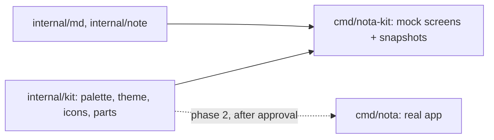

# Nota UI Kit Preview Implementation Plan

> **For agentic workers:** REQUIRED SUB-SKILL: Use superpowers:subagent-driven-development (recommended) or superpowers:executing-plans to implement this plan task-by-task. Steps use checkbox (`- [ ]`) syntax for tracking. When execution starts, save a copy of this plan to `docs/superpowers/plans/2026-10-28-nota-ui-kit.md`.

**Goal:** Build a new, standalone preview page for Nota's redesign with the MyGo native UI toolkit: minimal, crisp, and styled like shadcn/ui's zinc theme. Use mock data, and leave the original app untouched.

**Architecture:** A new package [internal/kit](internal/kit) owns the look: palette tokens, the mapping onto `ui.Theme`, embedded Lucide icons, and the small parts every screen reuses. A new binary [cmd/nota-kit](cmd/nota-kit) builds the redesigned screens from those parts with made-up notes. It covers the workspace, the command palette, settings, the welcome screen, and a kit gallery, and a headless test renders them to PNGs for review. Later, [cmd/nota](cmd/nota) imports the same package, so applying the design means swapping view code, not rewriting it.

**Tech Stack:** Go 1.27.3, `github.com/egoist/mygo` v0.7.1 (`ui`, `ui/editor`, `ui/markdown`), Lucide icons (lucide-static 0.468.0, ISC), and the existing `nota/internal/md` and `nota/internal/note` packages.

## Global Constraints

- Do not modify anything under `cmd/nota/` or the existing `internal/*` packages. Only add `internal/kit/`, `cmd/nota-kit/`, and `docs/design/`.
- No new Go module dependencies. MyGo stays at `v0.7.1`.
- Go is not on Git Bash's PATH. Run `export PATH="/c/Program Files/Go/bin:$PATH"` once per shell before any `go` command.
- Icons come from `https://unpkg.com/lucide-static@0.468.0/icons/<name>.svg`. Keep each file's `@license` comment and add the package `LICENSE`.
- Use exactly the hex values given in Task 1 for colors. The one hue is `Link` (indigo), reserved for wikilinks, tags, the current graph node, and the assistant icon.
- Corner radii are 8 for controls, 6 for rows and tabs, and 12 for dialogs. Theme `Spacing` is 4, the base font size is 14, and the editor column is at most 720 DIPs wide.
- Shortcut hints read `Ctrl` on Windows and Linux and `⌘` on macOS (`kit.Mod()`).
- Every commit uses Conventional Commits (`feat(kit): ...`, `docs(design): ...`).

## Design spec (what the preview must show)

```text
+------------------------------------------------------------------------------------------+
| [|]  projects / Nota roadmap     [ (o) Search notes or run a command   Ctrl K ]   [<> |pen| book] (*) (sync) (gear) [|] |
+------------------+----------------------------------------------------+------------------+
| [F] Field notes v|  Nota roadmap  x |  Sync design  |  2026-10-28      | [link|tree|#|graph|*] |
|  + New note  C N |----------------------------------------------------|  Backlinks       |
|  [] Today        |                                                    |   Sync design    |
|  Files           |          # Nota roadmap                            |   2026-10-28     |
|   > daily        |          A small offline vault. ...                |  Outgoing        |
|   v projects     |          (centered column, max 720 wide,           |   Sync design    |
|     Nota roadmap |           no gutter, line height 1.6)              |   ...            |
|  Tags            |                                                    |                  |
|  (#project 4) .. |                                                    |                  |
+------------------+----------------------------------------------------+------------------+
| projects/Nota roadmap.md   58 words                          . Synced   . Ollama ready   7 notes |
+------------------------------------------------------------------------------------------+
```

- **Title bar (44 tall, hairline below).** Ghost icon buttons only, with tooltips and no faces until hovered. A breadcrumb of the open note. A wide, quiet search trigger replaces the old New/Open/Search buttons. Source/Live/Reading becomes an icon segmented control.
- **Sidebar (248 wide, `Sidebar` color, hairline right).** Vault switcher, "New note" and "Today" rows, a Files tree with Lucide icons, and tag chips. Selected rows are soft gray, never black.
- **Tabs (40 tall).** Text tabs. The active tab gets a gray fill, and the close button shows only on the active or hovered tab.
- **Inspector (300 wide).** shadcn-style tabs list (icons only) for Links, Outline, Tags, Graph, and Assistant. The assistant shows chat bubbles, action chips, and a composer.
- **Status bar (28 tall).** Muted 12-DIP text with green status dots. Transient messages become toasts.
- **Command palette.** One dialog for notes and commands (Ctrl+K, also Ctrl+P and Ctrl+O). A borderless input, a gray selected row, and a key-hint footer.
- **Settings.** A 680-wide dialog with a left nav (General, Editor, Assistant, Sync) and a right `ui.Form`.
- **Welcome.** A centered 420-wide column with the logo mark, a primary "Open vault..." button, and a bordered Recent list.



---

### Task 1: Palette and theme mapping

**Files:**
- Create: [internal/kit/palette.go](internal/kit/palette.go)
- Create: [internal/kit/theme.go](internal/kit/theme.go)
- Test: [internal/kit/theme_test.go](internal/kit/theme_test.go)

**Interfaces:**
- Produces: `type Palette struct{...}`, `Light() Palette`, `Dark() Palette`, `Pick(mode string, systemDark bool) Palette`, `(Palette) Swatches() []Swatch`, `type Swatch struct{Name string; Color ui.Color}`, `Theme(p Palette, fontSize float32) *ui.Theme`, `Quiet(p Palette, fontSize float32) *ui.Theme`, `Apply(c *ui.Context, mode string, fontSize float32) Palette`, `Scoped(c *ui.Context, t *ui.Theme, fn func())`.

- [ ] **Step 1: Write the failing test** in `internal/kit/theme_test.go`

```go
package kit

import (
	"testing"

	"github.com/egoist/mygo/ui"
)

func TestPick(t *testing.T) {
	cases := []struct {
		mode      string
		sys, dark bool
	}{
		{"light", true, false},
		{"dark", false, true},
		{"system", true, true},
		{"system", false, false},
		{"", true, true},
	}
	for _, tc := range cases {
		if got := Pick(tc.mode, tc.sys).Dark; got != tc.dark {
			t.Errorf("Pick(%q, %v).Dark = %v, want %v", tc.mode, tc.sys, got, tc.dark)
		}
	}
}

func TestThemeUsesPalette(t *testing.T) {
	for _, p := range []Palette{Light(), Dark()} {
		th := Theme(p, 15)
		if th.Dark != p.Dark || th.Background != p.Background || th.Surface != p.Background ||
			th.Accent != p.Primary || th.AccentText != p.PrimaryForeground || th.Border != p.Border ||
			th.TextMuted != p.MutedForeground || th.Radius != 8 || th.FontSize != 15 {
			t.Errorf("Theme(dark=%v) = %+v", p.Dark, *th)
		}
	}
}

func TestQuietChoosesInGray(t *testing.T) {
	p := Light()
	q := Quiet(p, 0)
	if q.Accent != p.SidebarSelected || q.AccentText != p.Foreground || q.Surface != p.Sidebar {
		t.Errorf("Quiet accent %v, text %v, surface %v", q.Accent, q.AccentText, q.Surface)
	}
}

func TestApplyFollowsSystem(t *testing.T) {
	var got Palette
	tt := ui.NewTester(func(c *ui.Context) {
		got = Apply(c, "system", 0)
		ui.Text(c, "x")
	}, 200, 100)
	tt.Frame()
	if got.Dark {
		t.Fatal("a light system gave the dark palette")
	}
	tt.SetDark(true)
	tt.Frame()
	if !got.Dark {
		t.Error("a dark system gave the light palette")
	}
}

func TestScopedRestores(t *testing.T) {
	var inside, after ui.Color
	q := Quiet(Light(), 0)
	tt := ui.NewTester(func(c *ui.Context) {
		Apply(c, "light", 0)
		Scoped(c, q, func() { inside = c.Theme().Accent })
		after = c.Theme().Accent
	}, 200, 100)
	tt.Frame()
	if inside != Light().SidebarSelected || after != Light().Primary {
		t.Errorf("inside %v, after %v", inside, after)
	}
}
```

- [ ] **Step 2: Run it to verify it fails**

Run: `go test ./internal/kit/ -v`
Expected: FAIL with `undefined: Pick` (and the other kit names).

- [ ] **Step 3: Write `internal/kit/palette.go`**

```go
// Package kit is Nota's look: shadcn/ui's zinc palette mapped onto MyGo's
// theme, Lucide icons, and the few parts every screen is built from.
package kit

import "github.com/egoist/mygo/ui"

// Palette holds the colors a screen paints with, named as shadcn/ui names
// them. Link is the one hue, kept for wikilinks, tags and the graph.
type Palette struct {
	Dark              bool
	Background        ui.Color
	Foreground        ui.Color
	Muted             ui.Color
	MutedForeground   ui.Color
	Border            ui.Color
	Primary           ui.Color
	PrimaryHover      ui.Color
	PrimaryPressed    ui.Color
	PrimaryForeground ui.Color
	Hover             ui.Color
	Pressed           ui.Color
	Ring              ui.Color
	Destructive       ui.Color
	Success           ui.Color
	Warning           ui.Color
	Link              ui.Color
	Selection         ui.Color
	Sidebar           ui.Color
	SidebarSelected   ui.Color
	Scrollbar         ui.Color
}

// Light is shadcn's zinc theme for a light appearance.
func Light() Palette {
	return Palette{
		Background:        ui.Hex("#ffffff"),
		Foreground:        ui.Hex("#09090b"),
		Muted:             ui.Hex("#f4f4f5"),
		MutedForeground:   ui.Hex("#71717a"),
		Border:            ui.Hex("#e4e4e7"),
		Primary:           ui.Hex("#18181b"),
		PrimaryHover:      ui.Hex("#27272a"),
		PrimaryPressed:    ui.Hex("#3f3f46"),
		PrimaryForeground: ui.Hex("#fafafa"),
		Hover:             ui.Hex("#f4f4f5"),
		Pressed:           ui.Hex("#e4e4e7"),
		Ring:              ui.Hex("#a1a1aa"),
		Destructive:       ui.Hex("#ef4444"),
		Success:           ui.Hex("#16a34a"),
		Warning:           ui.Hex("#d97706"),
		Link:              ui.Hex("#4f46e5"),
		Selection:         ui.RGBA(99, 102, 241, 0.22),
		Sidebar:           ui.Hex("#fafafa"),
		SidebarSelected:   ui.Hex("#e4e4e7"),
		Scrollbar:         ui.RGBA(0, 0, 0, 0.18),
	}
}

// Dark is shadcn's zinc theme for a dark appearance.
func Dark() Palette {
	return Palette{
		Dark:              true,
		Background:        ui.Hex("#09090b"),
		Foreground:        ui.Hex("#fafafa"),
		Muted:             ui.Hex("#27272a"),
		MutedForeground:   ui.Hex("#a1a1aa"),
		Border:            ui.Hex("#27272a"),
		Primary:           ui.Hex("#fafafa"),
		PrimaryHover:      ui.Hex("#e4e4e7"),
		PrimaryPressed:    ui.Hex("#d4d4d8"),
		PrimaryForeground: ui.Hex("#18181b"),
		Hover:             ui.Hex("#27272a"),
		Pressed:           ui.Hex("#3f3f46"),
		Ring:              ui.Hex("#52525b"),
		Destructive:       ui.Hex("#f87171"),
		Success:           ui.Hex("#22c55e"),
		Warning:           ui.Hex("#f59e0b"),
		Link:              ui.Hex("#818cf8"),
		Selection:         ui.RGBA(129, 140, 248, 0.30),
		Sidebar:           ui.Hex("#18181b"),
		SidebarSelected:   ui.Hex("#3f3f46"),
		Scrollbar:         ui.RGBA(255, 255, 255, 0.16),
	}
}

// Pick returns the palette for mode, "system", "light" or "dark",
// following the system's appearance for "system" and anything else.
func Pick(mode string, systemDark bool) Palette {
	switch mode {
	case "light":
		return Light()
	case "dark":
		return Dark()
	}
	if systemDark {
		return Dark()
	}
	return Light()
}

// Swatch is a palette color with its token name, for the kit's gallery.
type Swatch struct {
	Name  string
	Color ui.Color
}

// Swatches lists p's colors in the order the gallery shows them.
func (p Palette) Swatches() []Swatch {
	return []Swatch{
		{"background", p.Background}, {"foreground", p.Foreground},
		{"muted", p.Muted}, {"muted-foreground", p.MutedForeground},
		{"border", p.Border}, {"primary", p.Primary},
		{"primary-foreground", p.PrimaryForeground}, {"hover", p.Hover},
		{"pressed", p.Pressed}, {"ring", p.Ring}, {"link", p.Link},
		{"destructive", p.Destructive}, {"success", p.Success},
		{"warning", p.Warning}, {"sidebar", p.Sidebar},
		{"sidebar-selected", p.SidebarSelected},
	}
}
```

- [ ] **Step 4: Write `internal/kit/theme.go`**

```go
package kit

import "github.com/egoist/mygo/ui"

// Theme returns MyGo's theme painted with p: controls are outlined on the
// background, as shadcn's outline buttons and inputs, and primary buttons,
// checks, switches, tooltips and toasts take the primary color. A
// fontSize of 0 keeps the system's size.
func Theme(p Palette, fontSize float32) *ui.Theme {
	t := ui.LightTheme()
	if p.Dark {
		t = ui.DarkTheme()
	}
	t.Background = p.Background
	t.Surface = p.Background
	t.SurfaceHover = p.Hover
	t.SurfacePressed = p.Pressed
	t.Border = p.Border
	t.Text = p.Foreground
	t.TextMuted = p.MutedForeground
	t.Accent = p.Primary
	t.AccentHover = p.PrimaryHover
	t.AccentPressed = p.PrimaryPressed
	t.AccentText = p.PrimaryForeground
	t.Danger = p.Destructive
	t.Warning = p.Warning
	t.Success = p.Success
	t.Selection = p.Selection
	t.Focus = p.Ring
	t.Inverse = p.Primary
	t.InverseText = p.PrimaryForeground
	t.Scrollbar = p.Scrollbar
	t.Radius = 8
	t.Spacing = 4
	if fontSize > 0 {
		t.FontSize = fontSize
	}
	return t
}

// Quiet returns the theme sidebars and lists are built in: their face is
// the sidebar's color, and the row chosen is a soft gray with the
// foreground on it instead of the primary color.
func Quiet(p Palette, fontSize float32) *ui.Theme {
	t := Theme(p, fontSize)
	t.Surface = p.Sidebar
	t.SurfaceHover = p.Hover
	t.SurfacePressed = p.SidebarSelected
	t.Accent = p.SidebarSelected
	t.AccentHover = p.SidebarSelected
	t.AccentPressed = p.SidebarSelected
	t.AccentText = p.Foreground
	return t
}

// Apply sets the frame's theme from mode and returns its palette. Call it
// first in a view: every frame starts from the system's theme, which tells
// whether the system is dark.
func Apply(c *ui.Context, mode string, fontSize float32) Palette {
	p := Pick(mode, c.Theme().Dark)
	c.SetTheme(Theme(p, fontSize))
	return p
}

// Scoped builds fn with t as the theme, then puts back the one before, so
// that only the widgets fn creates take t.
func Scoped(c *ui.Context, t *ui.Theme, fn func()) {
	prev := c.Theme()
	c.SetTheme(t)
	fn()
	c.SetTheme(prev)
}
```

- [ ] **Step 5: Run the tests to verify they pass**

Run: `go test ./internal/kit/ -v`
Expected: PASS for `TestPick`, `TestThemeUsesPalette`, `TestQuietChoosesInGray`, `TestApplyFollowsSystem`, `TestScopedRestores`.

- [ ] **Step 6: Commit**

```bash
git add internal/kit/palette.go internal/kit/theme.go internal/kit/theme_test.go
git commit -m "feat(kit): add shadcn zinc palette mapped onto MyGo themes"
```

---

### Task 2: Embedded Lucide icons

**Files:**
- Create: `internal/kit/icons/*.svg` (22 files) and `internal/kit/icons/LICENSE`
- Create: [internal/kit/icons.go](internal/kit/icons.go)
- Test: [internal/kit/icons_test.go](internal/kit/icons_test.go)

**Interfaces:**
- Produces: `IconNote, IconFolder, IconOpen, IconSearch, IconPlus, IconCommand, IconSettings, IconSync, IconAI, IconLink, IconOutline, IconTag, IconGraph, IconSidebar, IconInspector, IconClose, IconDaily, IconRead, IconSource, IconLive, IconSend, IconChevronDown *ui.SVG`, `type NamedIcon struct{Name string; SVG *ui.SVG}`, `AllIcons() []NamedIcon`.

- [ ] **Step 1: Download the icons** (all of these names returned HTTP 200 for 0.468.0)

```bash
mkdir -p internal/kit/icons
for n in file-text folder folder-open search plus command settings refresh-cw sparkles link list-tree hash waypoints panel-left panel-right x calendar-days book-open code pen-line arrow-up chevron-down; do
  curl -fsSL "https://unpkg.com/lucide-static@0.468.0/icons/$n.svg" -o "internal/kit/icons/$n.svg"
done
curl -fsSL "https://unpkg.com/lucide-static@0.468.0/LICENSE" -o internal/kit/icons/LICENSE
ls internal/kit/icons | wc -l
```

Expected: `23` (22 SVGs and the license).

- [ ] **Step 2: Write the failing test** in `internal/kit/icons_test.go`

```go
package kit

import "testing"

func TestIconsParse(t *testing.T) {
	all := AllIcons()
	if len(all) != 22 {
		t.Fatalf("%d icons, want 22", len(all))
	}
	for _, ic := range all {
		if w, h := ic.SVG.Size(); w != 24 || h != 24 {
			t.Errorf("%s is %vx%v, want 24x24", ic.Name, w, h)
		}
	}
}
```

- [ ] **Step 3: Run it to verify it fails**

Run: `go test ./internal/kit/ -run TestIconsParse -v`
Expected: FAIL with `undefined: AllIcons`.

- [ ] **Step 4: Write `internal/kit/icons.go`**

```go
package kit

import (
	"embed"

	"github.com/egoist/mygo/ui"
)

//go:embed icons/*.svg
var iconFiles embed.FS

// NamedIcon is an icon with its Lucide name.
type NamedIcon struct {
	Name string
	SVG  *ui.SVG
}

var named []NamedIcon

func loadIcon(name string) *ui.SVG {
	b, err := iconFiles.ReadFile("icons/" + name + ".svg")
	if err != nil {
		panic("kit: no icon " + name)
	}
	s := ui.MustParseSVG(b)
	named = append(named, NamedIcon{name, s})
	return s
}

// Icons from Lucide (lucide-static 0.468.0, ISC license, see icons/LICENSE).
var (
	IconNote        = loadIcon("file-text")
	IconFolder      = loadIcon("folder")
	IconOpen        = loadIcon("folder-open")
	IconSearch      = loadIcon("search")
	IconPlus        = loadIcon("plus")
	IconCommand     = loadIcon("command")
	IconSettings    = loadIcon("settings")
	IconSync        = loadIcon("refresh-cw")
	IconAI          = loadIcon("sparkles")
	IconLink        = loadIcon("link")
	IconOutline     = loadIcon("list-tree")
	IconTag         = loadIcon("hash")
	IconGraph       = loadIcon("waypoints")
	IconSidebar     = loadIcon("panel-left")
	IconInspector   = loadIcon("panel-right")
	IconClose       = loadIcon("x")
	IconDaily       = loadIcon("calendar-days")
	IconRead        = loadIcon("book-open")
	IconSource      = loadIcon("code")
	IconLive        = loadIcon("pen-line")
	IconSend        = loadIcon("arrow-up")
	IconChevronDown = loadIcon("chevron-down")
)

// AllIcons returns every icon of the kit with its Lucide name.
func AllIcons() []NamedIcon { return named }
```

- [ ] **Step 5: Run the tests to verify they pass**

Run: `go test ./internal/kit/ -v`
Expected: PASS. If `MustParseSVG` panics at init, the license comment is the likely cause. Fix that by stripping the leading `<!-- ... -->` line from each file with `sed -i '1{/^<!--/d}' internal/kit/icons/*.svg`, then re-run.

- [ ] **Step 6: Commit**

```bash
git add internal/kit/icons internal/kit/icons.go internal/kit/icons_test.go
git commit -m "feat(kit): embed Lucide icons"
```

---

### Task 3: Shared parts

**Files:**
- Create: [internal/kit/parts.go](internal/kit/parts.go)
- Test: [internal/kit/parts_test.go](internal/kit/parts_test.go)

**Interfaces:**
- Consumes: `Apply`, the `Icon*` vars.
- Produces: `Mod() string`, `IconButton(c *ui.Context, icon *ui.SVG, label string, on bool) ui.Element`, `NavRow(c *ui.Context, icon *ui.SVG, label string, selected bool, trail func()) ui.Element`, `SectionLabel(c *ui.Context, s string) ui.Element`, `Kbd(c *ui.Context, keys ...string) ui.Element`, `Dot(c *ui.Context, col ui.Color) ui.Element`, `Tabs(c *ui.Context, selected *int, icons []*ui.SVG, labels ...string) ui.Element`, `SearchTrigger(c *ui.Context, placeholder string) ui.Element`, `Dialog(c *ui.Context, open *bool, width float32, fn func()) ui.Element`, `EmptyState(c *ui.Context, icon *ui.SVG, title, hint, action string) bool`, `Chip(c *ui.Context, label, count string) ui.Element`.
- Every part creates its outermost element first, so callers may pass `c.Key(id)`.

- [ ] **Step 1: Write the failing test** in `internal/kit/parts_test.go`

```go
package kit

import (
	"testing"

	"github.com/egoist/mygo/ui"
)

func TestIconButtonClicks(t *testing.T) {
	n := 0
	tt := ui.NewTester(func(c *ui.Context) {
		Apply(c, "light", 0)
		if IconButton(c, IconSearch, "Search", false).Clicked() {
			n++
		}
	}, 200, 100)
	if err := tt.Click("Search"); err != nil {
		t.Fatal(err)
	}
	if n != 1 {
		t.Errorf("clicked %d times, want 1", n)
	}
}

func TestTabsChoose(t *testing.T) {
	sel := 0
	tt := ui.NewTester(func(c *ui.Context) {
		Apply(c, "light", 0)
		Tabs(c, &sel, nil, "Source", "Reading")
	}, 300, 100)
	if err := tt.Click("Reading"); err != nil {
		t.Fatal(err)
	}
	if sel != 1 {
		t.Errorf("selected %d, want 1", sel)
	}
}

func TestNavRowShowsTrail(t *testing.T) {
	clicked := false
	tt := ui.NewTester(func(c *ui.Context) {
		Apply(c, "light", 0)
		if NavRow(c, IconPlus, "New note", false, func() { Kbd(c, "Ctrl", "N") }).Clicked() {
			clicked = true
		}
	}, 300, 100)
	if !tt.HasText("New note") || !tt.HasText("Ctrl") {
		t.Fatalf("texts %q", tt.Texts())
	}
	if err := tt.Click("New note"); err != nil {
		t.Fatal(err)
	}
	if !clicked {
		t.Error("NavRow did not report the click")
	}
}
```

- [ ] **Step 2: Run it to verify it fails**

Run: `go test ./internal/kit/ -run 'TestIconButton|TestTabs|TestNavRow' -v`
Expected: FAIL with `undefined: IconButton`.

- [ ] **Step 3: Write `internal/kit/parts.go`**

```go
package kit

import (
	"runtime"

	"github.com/egoist/mygo/ui"
)

// Mod is the name of the key shortcuts use: ⌘ on macOS, Ctrl elsewhere.
func Mod() string {
	if runtime.GOOS == "darwin" {
		return "⌘"
	}
	return "Ctrl"
}

// IconButton is a ghost button showing icon alone: no face until hovered,
// a soft gray while pressed or while on is true. label is its tooltip and
// its name for assistive technology and tests.
func IconButton(c *ui.Context, icon *ui.SVG, label string, on bool) ui.Element {
	t := c.Theme()
	b := ui.ButtonBase(c).Size(28, 28).Radius(6).Label(label).Tooltip(label).TextColor(t.TextMuted)
	switch {
	case on || b.Pressed():
		b.Background(t.SurfacePressed).TextColor(t.Text)
	case b.Hovered():
		b.Background(t.SurfaceHover).TextColor(t.Text)
	}
	b.Children(func() { ui.Icon(c, icon).FontSize(16) })
	return b
}

// NavRow is a row of a sidebar, an inspector or a list: icon (nil for
// none), label, and what trail builds at its end, as a Badge or a Kbd (nil
// for nothing). It is gray while hovered, and a stronger gray with the
// full text color while selected.
func NavRow(c *ui.Context, icon *ui.SVG, label string, selected bool, trail func()) ui.Element {
	t := c.Theme()
	r := ui.ButtonBase(c).AlignSelf(ui.Stretch).Justify(ui.Start).Gap(8).Height(30).Padding(0, 8).Radius(6).TextColor(t.TextMuted)
	switch {
	case selected:
		r.Background(t.SurfacePressed).TextColor(t.Text)
	case r.Hovered():
		r.Background(t.SurfaceHover).TextColor(t.Text)
	}
	r.Children(func() {
		if icon != nil {
			ui.Icon(c, icon).FontSize(15)
		}
		ui.Text(c, label).SingleLine().Grow(1)
		if trail != nil {
			trail()
		}
	})
	return r
}

// SectionLabel is the small muted heading over a group, as shadcn's
// sidebar group label.
func SectionLabel(c *ui.Context, s string) ui.Element {
	t := c.Theme()
	return ui.Row(c).Padding(14, 8, 4, 8).Children(func() {
		ui.Text(c, s).FontSize(12).FontWeight(500).TextColor(t.TextMuted)
	})
}

// Kbd shows the keys of a shortcut as small outlined caps: Kbd(c, Mod(), "K").
func Kbd(c *ui.Context, keys ...string) ui.Element {
	t := c.Theme()
	return ui.Row(c).Gap(3).Shrink(0).Children(func() {
		for _, k := range keys {
			ui.Row(c).Height(18).Padding(0, 5).Radius(4).AlignItems(ui.Center).
				Border(1, t.Border).Background(t.Background).Children(func() {
				ui.Text(c, k).FontSize(11).TextColor(t.TextMuted)
			})
		}
	})
}

// Dot is a 6 DIP status dot: Success for ready, TextMuted for off.
func Dot(c *ui.Context, col ui.Color) ui.Element {
	return ui.Box(c).Size(6, 6).Radius(3).Background(col).Shrink(0)
}

// Tabs is shadcn's tabs list: a muted track whose chosen segment is raised
// on the background. With icons, they show in place of the labels, which
// become tooltips. Segments share the track's width when it is stretched.
func Tabs(c *ui.Context, selected *int, icons []*ui.SVG, labels ...string) ui.Element {
	t := c.Theme()
	seg := ui.SegmentedBase(c, selected, len(labels))
	seg.Track.Padding(3).Gap(2).Radius(8).Background(t.SurfaceHover).Children(func() {
		for i, label := range labels {
			s := seg.Segment(i).Grow(1).Height(26).Padding(0, 10).Radius(6).
				Justify(ui.Center).AlignItems(ui.Center).Label(label).TextColor(t.TextMuted)
			if i == *selected {
				s.Background(t.Background).TextColor(t.Text).Shadow(0, 1, 2, 0, ui.RGBA(0, 0, 0, 0.08))
			} else if s.Hovered() {
				s.TextColor(t.Text)
			}
			if icons != nil {
				s.Tooltip(label)
			}
			s.Children(func() {
				if icons != nil {
					ui.Icon(c, icons[i]).FontSize(15)
					return
				}
				ui.Text(c, label).FontSize(t.FontSize - 1).FontWeight(500).SingleLine()
			})
		}
	})
	return seg.Track
}

// SearchTrigger is the quiet, wide field that opens the command palette:
// an icon, placeholder text and the shortcut. It is a button; ask Clicked.
func SearchTrigger(c *ui.Context, placeholder string) ui.Element {
	t := c.Theme()
	b := ui.ButtonBase(c).Width(340).Height(30).Padding(0, 6, 0, 10).Gap(8).Radius(8).
		Border(1, t.Border).Background(t.Background).TextColor(t.TextMuted).Label(placeholder)
	if b.Hovered() {
		b.Background(t.SurfaceHover)
	}
	b.Children(func() {
		ui.Icon(c, IconSearch).FontSize(14)
		ui.Text(c, placeholder).FontSize(t.FontSize - 1).SingleLine().Grow(1)
		Kbd(c, Mod(), "K")
	})
	return b
}

// Dialog is a modal panel in the kit's look, width DIPs wide: a hairline
// border, 12 DIP corners and a soft shadow over a lightly dimmed window.
// fn builds its content edge to edge; pad inside it.
func Dialog(c *ui.Context, open *bool, width float32, fn func()) ui.Element {
	t := c.Theme()
	return ui.DialogBase(c, open, func(backdrop, panel ui.Element) {
		backdrop.Background(ui.RGBA(0, 0, 0, 0.3))
		panel.Width(width).Radius(12).Border(1, t.Border).Background(t.Background).
			Shadow(0, 16, 40, 0, ui.RGBA(0, 0, 0, 0.16)).Clip()
		fn()
	})
}

// EmptyState centers an icon, a title, a hint and, unless action is "",
// a button. It reports whether the button was clicked.
func EmptyState(c *ui.Context, icon *ui.SVG, title, hint, action string) bool {
	t := c.Theme()
	clicked := false
	ui.Column(c).Grow(1).Center().Gap(6).Padding(24).Children(func() {
		ui.Icon(c, icon).FontSize(22).TextColor(t.TextMuted)
		ui.Text(c, title).FontWeight(600)
		ui.Text(c, hint).FontSize(t.FontSize - 1).TextColor(t.TextMuted)
		if action != "" && ui.Button(c, action).Clicked() {
			clicked = true
		}
	})
	return clicked
}

// Chip is a small outlined pill, as "#project 4", that reports Clicked.
func Chip(c *ui.Context, label, count string) ui.Element {
	t := c.Theme()
	b := ui.ButtonBase(c).Height(24).Padding(0, 8).Gap(6).Radius(999).Border(1, t.Border).TextColor(t.Text)
	if b.Hovered() {
		b.Background(t.SurfaceHover)
	}
	b.Children(func() {
		ui.Text(c, label).FontSize(12)
		if count != "" {
			ui.Text(c, count).FontSize(12).TextColor(t.TextMuted)
		}
	})
	return b
}
```

- [ ] **Step 4: Run the tests to verify they pass**

Run: `go test ./internal/kit/ -v`
Expected: all kit tests PASS.

- [ ] **Step 5: Commit**

```bash
git add internal/kit/parts.go internal/kit/parts_test.go
git commit -m "feat(kit): add shared parts for the new look"
```

---

### Task 4: Preview app with the workspace screen

**Files:**
- Create: [cmd/nota-kit/main.go](cmd/nota-kit/main.go), [cmd/nota-kit/mock.go](cmd/nota-kit/mock.go), [cmd/nota-kit/workspace.go](cmd/nota-kit/workspace.go), [cmd/nota-kit/inspector.go](cmd/nota-kit/inspector.go)
- Test: [cmd/nota-kit/main_test.go](cmd/nota-kit/main_test.go)

**Interfaces:**
- Consumes: everything in `internal/kit`; `md.ForPreview(src string, embed func(string) (string, bool)) string`; `md.Parse(src).Headings` (`Level`, `Text`, `Line`); `note.TitleFromName(path string) string`.
- Produces (used by Tasks 5 to 7): `newPreview() *preview`, `preview{screen int; ws *workspace; gallery galleryState}`, `screenWorkspace/screenWelcome/screenKit`, `workspace` fields `set prefs`, `palette bool`, `query string`, `paletteList ui.ListState`, `paletteSel int`, `settings bool`, `settingsSec int`, `mode int`, `pane int`; methods `current() string`, `open(path string)`, `openPalette()`; constants `modeSource/modeLive/modeRead`, `paneLinks/paneOutline/paneTags/paneGraph/paneAI`; `mockPaths() []string`, `mockCommands []string`, `mockRecent`, `noEmbed`.

- [ ] **Step 1: Write the failing test** in `cmd/nota-kit/main_test.go`

```go
package main

import (
	"testing"

	"github.com/egoist/mygo/ui"
)

const width, height = 1280, 820

func TestWorkspaceShowsShell(t *testing.T) {
	p := newPreview()
	tt := ui.NewTester(p.view, width, height)
	for _, s := range []string{"Field notes", "Files", "Tags", "Backlinks", "Synced", "Search notes or run a command"} {
		if !tt.HasText(s) {
			t.Errorf("no %q in %q", s, tt.Texts())
		}
	}
}

func TestClosingLastTabShowsEmptyState(t *testing.T) {
	p := newPreview()
	p.ws.tabs = p.ws.tabs[:1]
	tt := ui.NewTester(p.view, width, height)
	if err := tt.Click("Close Nota roadmap"); err != nil {
		t.Fatal(err)
	}
	if !tt.HasText("No note open") {
		t.Errorf("after closing the last tab: %q", tt.Texts())
	}
}
```

- [ ] **Step 2: Run it to verify it fails**

Run: `go test ./cmd/nota-kit/ -v`
Expected: FAIL with `undefined: newPreview`.

- [ ] **Step 3: Write `cmd/nota-kit/mock.go`**

```go
package main

import (
	"maps"
	"slices"
)

const mockVault = "Field notes"

var mockRecent = []struct{ Name, Dir string }{
	{"Field notes", `D:\notes`},
	{"Team wiki", `D:\work`},
	{"Journal", `C:\Users\you\Documents`},
}

var mockDirs = map[string]bool{"daily": true, "projects": true, "reading": true}

var mockRoots = []string{"daily", "projects", "reading", "Inbox.md", "Start here.md"}

var mockKids = map[string][]string{
	"daily":    {"daily/2026-10-27.md", "daily/2026-10-28.md"},
	"projects": {"projects/Nota roadmap.md", "projects/Sync design.md"},
	"reading":  {"reading/Local-first software.md"},
}

func mockChildren(p string) []string { return mockKids[p] }

var mockNotes = map[string]string{
	"projects/Nota roadmap.md": `# Nota roadmap

A small offline vault. Notes stay files; AI is optional.

## Now

- [x] Native window with MyGo
- [ ] New look from the UI kit #project
- [ ] Sync over [[Sync design|git and folders]]

## Next

Read ==local-first== ideas in [[Local-first software]], then write them up in the [[Inbox]].

> One accent, hairlines, and room to breathe.
`,
	"projects/Sync design.md":         "# Sync design\n\nGit, a folder, or `nota serve`. Conflicts become a copy: `note (conflict device date).md`.\n\nSee [[Nota roadmap]].\n",
	"reading/Local-first software.md": "# Local-first software\n\nSeven ideals: fast, multi-device, offline, collaboration, longevity, privacy, user control. #reading\n",
	"daily/2026-10-28.md":             "# 2026-10-28\n\n- Reviewed the [[Nota roadmap]]\n- Tried the new palette #idea\n",
	"daily/2026-10-27.md":             "# 2026-10-27\n\n- Sketched the sidebar #idea\n",
	"Inbox.md":                        "# Inbox\n\n- Shortcuts cheat sheet #idea\n",
	"Start here.md":                   "# Start here\n\nThis is a preview vault with made-up notes.\n",
}

// mockPaths returns the notes' paths in order.
func mockPaths() []string { return slices.Sorted(maps.Keys(mockNotes)) }

var mockTags = []struct {
	Tag string
	N   int
}{{"project", 4}, {"idea", 3}, {"reading", 2}, {"daily", 2}, {"sync", 1}}

var mockBacklinks = map[string][]string{
	"projects/Nota roadmap.md":        {"projects/Sync design.md", "daily/2026-10-28.md"},
	"projects/Sync design.md":         {"projects/Nota roadmap.md"},
	"reading/Local-first software.md": {"projects/Nota roadmap.md"},
	"Inbox.md":                        {"projects/Nota roadmap.md"},
}

var mockOutgoing = map[string][]string{
	"projects/Nota roadmap.md": {"projects/Sync design.md", "reading/Local-first software.md", "Inbox.md"},
	"projects/Sync design.md":  {"projects/Nota roadmap.md"},
	"daily/2026-10-28.md":      {"projects/Nota roadmap.md"},
}

// mockGraph places notes in the graph pane, in fractions of its size.
var mockGraph = map[string][2]float32{
	"projects/Nota roadmap.md":        {0.5, 0.45},
	"projects/Sync design.md":         {0.2, 0.2},
	"reading/Local-first software.md": {0.72, 0.22},
	"Inbox.md":                        {0.7, 0.75},
	"daily/2026-10-28.md":             {0.22, 0.72},
}

var mockEdges = [][2]string{
	{"projects/Nota roadmap.md", "projects/Sync design.md"},
	{"projects/Nota roadmap.md", "reading/Local-first software.md"},
	{"projects/Nota roadmap.md", "Inbox.md"},
	{"daily/2026-10-28.md", "projects/Nota roadmap.md"},
}

var mockCommands = []string{"New note", "Open today's note", "Toggle sidebar", "Toggle side panel", "Summarize note", "Index vault for Ask", "Sync now", "Open settings"}

var mockChat = []struct{ Role, Text string }{
	{"user", "Summarize this note"},
	{"assistant", "The roadmap keeps notes as plain files. **Now:** the new look and sync over [[Sync design]]. **Next:** reading on local-first software."},
}

func noEmbed(string) (string, bool) { return "", false }
```

- [ ] **Step 4: Write `cmd/nota-kit/main.go`**

```go
// Command nota-kit previews Nota's new look with made-up notes: the
// workspace, the welcome screen, the command palette, settings and the
// kit's parts. It reads and writes nothing.
//
//	go run ./cmd/nota-kit
package main

import (
	"log"

	"github.com/egoist/mygo"
	"github.com/egoist/mygo/ui"

	"nota/internal/kit"
)

const (
	screenWorkspace = iota
	screenWelcome
	screenKit
)

type preview struct {
	screen  int
	ws      *workspace
	gallery galleryState
}

// galleryState holds the kit gallery's sample controls (Task 6 builds them).
type galleryState struct {
	text, search, choice string
	on, check            bool
	num                  float64
	tab, iconTab         int
}

func newPreview() *preview {
	return &preview{ws: newWorkspace(), gallery: galleryState{choice: "llama3.2", num: 14, on: true}}
}

func (p *preview) view(c *ui.Context) {
	pal := kit.Apply(c, p.ws.set.themeName(), float32(p.ws.set.font))
	ui.Column(c).Fill().Background(pal.Background).Children(func() {
		p.bar(c)
		switch p.screen {
		default:
			p.ws.view(c, pal)
		}
	})
}

// bar is the preview's own strip, not part of the design: which screen,
// and which appearance. Its dashed edge sets it apart.
func (p *preview) bar(c *ui.Context) {
	t := c.Theme()
	ui.Row(c).Height(40).Shrink(0).Padding(0, 12).Gap(12).AlignItems(ui.Center).
		BorderWidth(0, 0, 1, 0).BorderColor(t.Border).BorderStyle(ui.BorderDashed).Children(func() {
		ui.Text(c, "UI kit preview").FontSize(12).FontWeight(600).TextColor(t.TextMuted)
		kit.Tabs(c, &p.screen, nil, "Workspace", "Welcome", "Kit")
		ui.Spacer(c)
		kit.Tabs(c, &p.ws.set.theme, nil, "System", "Light", "Dark")
	})
}

func main() {
	p := newPreview()
	mygo.App.WhenReady(func() {
		mygo.NewWindow(mygo.WindowOptions{
			Title: "Nota - UI kit preview", Width: 1280, Height: 820,
			MinWidth: 900, MinHeight: 560,
			Content: ui.View(p.view),
		})
	})
	if err := mygo.App.Run(); err != nil {
		log.Fatal(err)
	}
}
```

- [ ] **Step 5: Write `cmd/nota-kit/workspace.go`**

```go
package main

import (
	"strconv"
	"strings"

	"github.com/egoist/mygo/ui"
	"github.com/egoist/mygo/ui/editor"
	"github.com/egoist/mygo/ui/markdown"

	"nota/internal/kit"
	"nota/internal/md"
	"nota/internal/note"
)

const (
	modeSource = iota
	modeLive
	modeRead
)

const (
	paneLinks = iota
	paneOutline
	paneTags
	paneGraph
	paneAI
)

// prefs stands in for settings.Settings.
type prefs struct {
	theme                            int // 0 system, 1 light, 2 dark
	font                             float64
	wrap                             bool
	daily, templates                 string
	endpoint, chatModel, embedModel  string
	apiKey                           string
	syncMode                         int
	remote, token                    string
}

func (p prefs) themeName() string { return [...]string{"system", "light", "dark"}[p.theme] }

// workspace is the main screen: the state the real App keeps, filled with
// mock notes.
type workspace struct {
	set prefs

	sideOpen, inspOpen bool
	tree               ui.OutlineState[string]
	fileRow            int
	lastRow            string

	tabs   []string
	active int
	states map[string]*editor.State
	mode   int
	pane   int

	palette     bool
	query       string
	paletteList ui.ListState
	paletteSel  int

	settings    bool
	settingsSec int

	aiInput string
	mdOpts  markdown.Options
	mdTheme markdown.Theme
}

func newWorkspace() *workspace {
	return &workspace{
		set: prefs{font: 14, wrap: true, daily: "daily/2006-01-02", templates: "templates",
			endpoint: "http://localhost:11434/v1", chatModel: "llama3.2", embedModel: "nomic-embed-text"},
		sideOpen: true, inspOpen: true, fileRow: -1,
		tabs:   []string{"projects/Nota roadmap.md", "projects/Sync design.md", "daily/2026-10-28.md"},
		states: map[string]*editor.State{},
	}
}

func (w *workspace) current() string {
	if w.active < 0 || w.active >= len(w.tabs) {
		return ""
	}
	return w.tabs[w.active]
}

func (w *workspace) open(path string) {
	if mockDirs[path] {
		return
	}
	for i, t := range w.tabs {
		if t == path {
			w.active = i
			return
		}
	}
	w.tabs = append(w.tabs, path)
	w.active = len(w.tabs) - 1
}

func (w *workspace) close(i int) {
	w.tabs = append(w.tabs[:i], w.tabs[i+1:]...)
	if w.active >= len(w.tabs) {
		w.active = len(w.tabs) - 1
	}
	if w.active < 0 {
		w.active = 0
	}
}

func (w *workspace) openPalette() { w.palette, w.query, w.paletteSel = true, "", 0 }

func (w *workspace) view(c *ui.Context, p kit.Palette) {
	if c.Shortcut(ui.Cmd, ui.KeyK) || c.Shortcut(ui.Cmd, ui.KeyP) || c.Shortcut(ui.Cmd, ui.KeyO) {
		w.openPalette()
	}
	if c.Shortcut(ui.Cmd, ui.KeyBackslash) {
		w.sideOpen = !w.sideOpen
	}
	if c.Shortcut(ui.Cmd, ui.KeyE) {
		w.mode = (w.mode + 1) % 3
	}
	w.styleMarkdown(c, p)
	ui.Column(c).Grow(1).Children(func() {
		w.titleBar(c)
		ui.Row(c).Grow(1).AlignItems(ui.Stretch).Children(func() {
			if w.sideOpen {
				w.sidebar(c, p)
			}
			w.center(c, p)
			if w.inspOpen {
				w.inspector(c, p)
			}
		})
		w.statusBar(c, p)
	})
}

func (w *workspace) styleMarkdown(c *ui.Context, p kit.Palette) {
	w.mdTheme = markdown.Theme{
		FontSize: float32(w.set.font) + 1, LineHeight: 1.65,
		Link: p.Link, Muted: c.Theme().TextMuted, CodeBackground: p.Muted,
		Mark: ui.RGBA(250, 204, 21, 0.4),
	}
	w.mdOpts.WrapCode = true
	w.mdOpts.OnLink = func(string) {}
	w.mdOpts.Theme = &w.mdTheme
}

func (w *workspace) titleBar(c *ui.Context) {
	t := c.Theme()
	ui.Row(c).Height(44).Shrink(0).Padding(0, 8).Gap(4).AlignItems(ui.Center).
		BorderWidth(0, 0, 1, 0).BorderColor(t.Border).Children(func() {
		if kit.IconButton(c, kit.IconSidebar, "Toggle sidebar", false).Clicked() {
			w.sideOpen = !w.sideOpen
		}
		w.breadcrumb(c)
		ui.Spacer(c)
		if kit.SearchTrigger(c, "Search notes or run a command").Clicked() {
			w.openPalette()
		}
		ui.Spacer(c)
		kit.Tabs(c, &w.mode, []*ui.SVG{kit.IconSource, kit.IconLive, kit.IconRead}, "Source", "Live", "Reading")
		ui.Box(c).Width(4)
		if kit.IconButton(c, kit.IconAI, "Assistant", w.inspOpen && w.pane == paneAI).Clicked() {
			w.inspOpen, w.pane = true, paneAI
		}
		if kit.IconButton(c, kit.IconSync, "Sync", false).Clicked() {
			c.Toast("Synced with git · nothing waiting")
		}
		if kit.IconButton(c, kit.IconSettings, "Settings", false).Clicked() {
			w.settings = true
		}
		if kit.IconButton(c, kit.IconInspector, "Toggle side panel", false).Clicked() {
			w.inspOpen = !w.inspOpen
		}
	})
}

func (w *workspace) breadcrumb(c *ui.Context) {
	t := c.Theme()
	path := w.current()
	if path == "" {
		return
	}
	parts := strings.Split(path, "/")
	ui.Row(c).Gap(6).PaddingX(4).AlignItems(ui.Center).Children(func() {
		for i, part := range parts {
			if i > 0 {
				ui.Text(c, "/").FontSize(t.FontSize - 1).TextColor(t.TextMuted.Alpha(0.6))
			}
			if i == len(parts)-1 {
				ui.Text(c, note.TitleFromName(part)).FontSize(t.FontSize - 1).FontWeight(500).SingleLine()
				continue
			}
			ui.Text(c, part).FontSize(t.FontSize - 1).TextColor(t.TextMuted).SingleLine()
		}
	})
}

func (w *workspace) sidebar(c *ui.Context, p kit.Palette) {
	kit.Scoped(c, kit.Quiet(p, c.Theme().FontSize), func() {
		t := c.Theme()
		ui.Column(c).Width(248).Shrink(0).Padding(8).Gap(2).Background(t.Surface).
			BorderWidth(0, 1, 0, 0).BorderColor(t.Border).Children(func() {
			w.vaultSwitcher(c, p)
			if kit.NavRow(c, kit.IconPlus, "New note", false, func() { kit.Kbd(c, kit.Mod(), "N") }).Clicked() {
				c.Toast("New note")
			}
			if kit.NavRow(c, kit.IconDaily, "Today", false, nil).Clicked() {
				w.open("daily/2026-10-28.md")
			}
			kit.SectionLabel(c, "Files")
			w.tree.List.Selected = &w.fileRow
			ui.Outline(c, &w.tree, mockRoots, mockChildren, func(path string) {
				icon := kit.IconNote
				if mockDirs[path] {
					icon = kit.IconFolder
				}
				ui.Row(c).Grow(1).Gap(8).AlignItems(ui.Center).Children(func() {
					ui.Icon(c, icon).FontSize(15).TextColor(t.TextMuted)
					ui.Text(c, note.TitleFromName(path)).SingleLine()
				})
			}).Grow(1)
			if w.fileRow >= 0 && w.fileRow < w.tree.Rows() {
				if item := w.tree.Item(w.fileRow); item != w.lastRow {
					w.lastRow = item
					w.open(item)
				}
			}
			kit.SectionLabel(c, "Tags")
			ui.Row(c).Wrap().Gap(6).Padding(0, 8, 8, 8).Children(func() {
				for _, tg := range mockTags {
					if kit.Chip(c.Key(tg.Tag), "#"+tg.Tag, strconv.Itoa(tg.N)).Clicked() {
						w.inspOpen, w.pane = true, paneTags
					}
				}
			})
		})
	})
}

func (w *workspace) vaultSwitcher(c *ui.Context, p kit.Palette) {
	t := c.Theme()
	b := ui.ButtonBase(c).AlignSelf(ui.Stretch).Justify(ui.Start).Height(44).Padding(0, 8).Gap(10).Radius(8)
	if b.Hovered() {
		b.Background(t.SurfaceHover)
	}
	b.Children(func() {
		ui.Row(c).Size(28, 28).Radius(7).Background(p.Primary).Justify(ui.Center).AlignItems(ui.Center).Children(func() {
			ui.Text(c, "F").FontWeight(700).TextColor(p.PrimaryForeground)
		})
		ui.Column(c).Grow(1).Gap(1).Children(func() {
			ui.Text(c, mockVault).FontWeight(600).SingleLine()
			ui.Text(c, strconv.Itoa(len(mockNotes))+" notes").FontSize(12).TextColor(t.TextMuted)
		})
		ui.Icon(c, kit.IconChevronDown).FontSize(14).TextColor(t.TextMuted)
	})
	if b.Clicked() {
		c.Toast("Open another vault…")
	}
}

func (w *workspace) center(c *ui.Context, p kit.Palette) {
	ui.Column(c).Grow(1).MinWidth(0).Children(func() {
		w.tabStrip(c)
		path := w.current()
		switch {
		case path == "":
			if kit.EmptyState(c, kit.IconNote, "No note open", "Pick a note on the left, or start a new one.", "New note") {
				c.Toast("New note")
			}
		case w.mode == modeRead:
			w.reading(c, path)
		default:
			w.source(c, p, path)
		}
	})
}

func (w *workspace) tabStrip(c *ui.Context) {
	t := c.Theme()
	closeAt := -1
	ui.Row(c).Height(40).Shrink(0).Padding(0, 8).Gap(2).AlignItems(ui.Center).
		BorderWidth(0, 0, 1, 0).BorderColor(t.Border).Children(func() {
		for i, path := range w.tabs {
			on := i == w.active
			name := note.TitleFromName(path)
			tab := ui.Row(c.Key(path)).Height(28).Padding(0, 4, 0, 10).Gap(4).Radius(6).AlignItems(ui.Center)
			hover := tab.Hovered()
			if on || hover {
				tab.Background(t.SurfaceHover)
			}
			tab.Children(func() {
				label := ui.ButtonBase(c).Children(func() {
					txt := ui.Text(c, name).FontSize(t.FontSize - 1).SingleLine().MaxWidth(180)
					if !on {
						txt.TextColor(t.TextMuted)
					}
				})
				if label.Clicked() {
					w.active = i
				}
				if on || hover {
					if kit.IconButton(c, kit.IconClose, "Close "+name, false).Size(20, 20).Clicked() {
						closeAt = i
					}
				} else {
					ui.Box(c).Size(20, 20)
				}
			})
		}
	})
	if closeAt >= 0 {
		w.close(closeAt)
	}
}

// source is the editor, in a centered column with no gutter.
func (w *workspace) source(c *ui.Context, p kit.Palette, path string) {
	st := w.states[path]
	if st == nil {
		buf := editor.NewBuffer(mockNotes[path])
		buf.SetLanguage(editor.LanguageFor(path))
		st = &editor.State{Buffer: buf, LineNumbers: editor.LineNumbersOff, NoFolding: true, Placeholder: "Start writing…"}
		w.states[path] = st
	}
	st.SoftWrap = w.set.wrap
	st.LineHeight = 1.6
	st.Font.Size = float32(w.set.font)
	th := editor.DefaultTheme(c.Theme())
	th.ActiveLine = ui.Transparent
	th.Tokens[editor.TokenLink].Color = p.Link
	if w.mode == modeLive {
		th.Tokens[editor.TokenMeta].Color = c.Theme().TextMuted.Alpha(0.45)
	}
	st.Theme = th
	ui.Row(c.Key(path)).Grow(1).Justify(ui.Center).Padding(36, 24, 0, 24).Children(func() {
		editor.View(c, st).Grow(1).MaxWidth(720)
	})
}

func (w *workspace) reading(c *ui.Context, path string) {
	src := md.ForPreview(mockNotes[path], noEmbed)
	ui.Scroll(c.Key(path)).Grow(1).Children(func() {
		ui.Row(c).Justify(ui.Center).Padding(40, 24).Children(func() {
			ui.Column(c).Grow(1).MaxWidth(720).Children(func() {
				markdown.View(c, src, &w.mdOpts)
			})
		})
	})
}

func (w *workspace) statusBar(c *ui.Context, p kit.Palette) {
	t := c.Theme()
	small := func(s string) { ui.Text(c, s).FontSize(12).TextColor(t.TextMuted).SingleLine() }
	ui.Row(c).Height(28).Shrink(0).Padding(0, 12).Gap(16).AlignItems(ui.Center).
		BorderWidth(1, 0, 0, 0).BorderColor(t.Border).Children(func() {
		if path := w.current(); path != "" {
			small(path)
			small(strconv.Itoa(len(strings.Fields(mockNotes[path]))) + " words")
		}
		ui.Spacer(c)
		ui.Row(c).Gap(6).AlignItems(ui.Center).Children(func() { kit.Dot(c, p.Success); small("Synced") })
		ui.Row(c).Gap(6).AlignItems(ui.Center).Children(func() { kit.Dot(c, p.Success); small("Ollama ready") })
		small(strconv.Itoa(len(mockNotes)) + " notes")
	})
}
```

- [ ] **Step 6: Write `cmd/nota-kit/inspector.go`**

```go
package main

import (
	"strconv"
	"strings"

	"github.com/egoist/mygo/ui"
	"github.com/egoist/mygo/ui/editor"
	"github.com/egoist/mygo/ui/markdown"

	"nota/internal/kit"
	"nota/internal/md"
	"nota/internal/note"
)

func (w *workspace) inspector(c *ui.Context, p kit.Palette) {
	t := c.Theme()
	ui.Column(c).Width(300).Shrink(0).Padding(12).Gap(8).BorderWidth(0, 0, 0, 1).BorderColor(t.Border).Children(func() {
		kit.Tabs(c, &w.pane, []*ui.SVG{kit.IconLink, kit.IconOutline, kit.IconTag, kit.IconGraph, kit.IconAI},
			"Links", "Outline", "Tags", "Graph", "Assistant").AlignSelf(ui.Stretch)
		path := w.current()
		switch w.pane {
		case paneLinks:
			w.linksPane(c, path)
		case paneOutline:
			w.outlinePane(c, path)
		case paneTags:
			w.tagsPane(c)
		case paneGraph:
			w.graphPane(c, p, path)
		default:
			w.aiPane(c, p)
		}
	})
}

func hint(c *ui.Context, s string) {
	ui.Row(c).Padding(4, 8).Children(func() {
		ui.Text(c, s).FontSize(12).TextColor(c.Theme().TextMuted)
	})
}

func (w *workspace) linksPane(c *ui.Context, path string) {
	if path == "" {
		kit.EmptyState(c, kit.IconLink, "No note open", "Links to and from a note show here.", "")
		return
	}
	ui.Scroll(c).Grow(1).Children(func() {
		ui.Column(c).Gap(2).Children(func() {
			group := func(name string, paths []string) {
				kit.SectionLabel(c, name)
				if len(paths) == 0 {
					hint(c, "None yet")
				}
				for _, q := range paths {
					if kit.NavRow(c.Key(name+q), kit.IconNote, note.TitleFromName(q), false, nil).Clicked() {
						w.open(q)
					}
				}
			}
			group("Backlinks", mockBacklinks[path])
			group("Outgoing", mockOutgoing[path])
		})
	})
}

func (w *workspace) outlinePane(c *ui.Context, path string) {
	doc := md.Parse(mockNotes[path])
	if len(doc.Headings) == 0 {
		kit.EmptyState(c, kit.IconOutline, "No headings", "Lines starting with # show here.", "")
		return
	}
	ui.Column(c).Gap(2).Children(func() {
		for i, h := range doc.Headings {
			ui.Row(c.Key(i)).PaddingStart(float32(h.Level-1) * 12).Children(func() {
				if kit.NavRow(c, nil, h.Text, false, nil).Grow(1).Clicked() {
					if st := w.states[path]; st != nil {
						st.GoTo(editor.Pos{Line: h.Line})
					}
				}
			})
		}
	})
}

func (w *workspace) tagsPane(c *ui.Context) {
	ui.Column(c).Gap(2).Children(func() {
		kit.SectionLabel(c, "All tags")
		for _, tg := range mockTags {
			kit.NavRow(c.Key(tg.Tag), kit.IconTag, tg.Tag, false, func() {
				ui.Badge(c, strconv.Itoa(tg.N))
			})
		}
	})
}

func (w *workspace) graphPane(c *ui.Context, p kit.Palette, path string) {
	t := c.Theme()
	edge, dot, label := t.Border, t.TextMuted, t.Text
	box := ui.Box(c).Grow(1).Fill().Radius(8).Border(1, t.Border)
	box.Draw(func(pt *ui.Painter, r ui.Rect) {
		at := func(id string) (float32, float32) {
			v := mockGraph[id]
			return r.X + v[0]*r.W, r.Y + v[1]*r.H
		}
		for _, e := range mockEdges {
			x1, y1 := at(e[0])
			x2, y2 := at(e[1])
			pt.Line(x1, y1, x2, y2, 1, edge)
		}
		for id := range mockGraph {
			x, y := at(id)
			col := dot
			if id == path {
				col = p.Link
			}
			pt.Fill(ui.Rect{X: x - 4, Y: y - 4, W: 8, H: 8}, col, 4)
			pt.Text(x+8, y+4, note.TitleFromName(id), 11, label)
		}
	})
}

func (w *workspace) aiPane(c *ui.Context, p kit.Palette) {
	t := c.Theme()
	ui.Row(c).Wrap().Gap(6).Children(func() {
		for _, a := range []string{"Summarize", "Rewrite", "Continue", "Title & tags"} {
			if kit.Chip(c.Key(a), a, "").Clicked() {
				c.Toast(a + "…")
			}
		}
	})
	ui.Scroll(c).Grow(1).Children(func() {
		ui.Column(c).Gap(12).PaddingY(8).Children(func() {
			for i, m := range mockChat {
				if m.Role == "user" {
					ui.Row(c.Key(i)).Justify(ui.End).Children(func() {
						ui.Row(c).Padding(6, 10).Radius(10).Background(t.SurfaceHover).MaxWidth(220).Children(func() {
							ui.Text(c, m.Text)
						})
					})
					continue
				}
				ui.Row(c.Key(i)).Gap(8).Children(func() {
					ui.Icon(c, kit.IconAI).FontSize(14).TextColor(p.Link)
					ui.Column(c).Grow(1).MinWidth(0).Children(func() {
						markdown.View(c, md.ForPreview(m.Text, noEmbed), &w.mdOpts)
					})
				})
			}
		})
	})
	ui.Row(c).Gap(6).AlignItems(ui.Center).Padding(4).Radius(10).Border(1, t.Border).Children(func() {
		in := ui.TextInput(c, &w.aiInput).Placeholder("Ask about this note…").Grow(1).
			Border(0, ui.Transparent).Background(ui.Transparent)
		send := ui.PrimaryButton(c, "").Size(28, 28).Padding(0).Radius(8).Label("Send").Children(func() {
			ui.Icon(c, kit.IconSend).FontSize(15)
		})
		if (in.Submitted() || send.Clicked()) && strings.TrimSpace(w.aiInput) != "" {
			c.Toast("Asked: " + w.aiInput)
			w.aiInput = ""
		}
	})
	ui.Text(c, "Ollama · llama3.2 · answers stay on this device").FontSize(11).TextColor(t.TextMuted)
}
```

- [ ] **Step 7: Run the tests and vet**

Run: `go vet ./cmd/nota-kit/ && go test ./cmd/nota-kit/ -v`
Expected: PASS for `TestWorkspaceShowsShell` and `TestClosingLastTabShowsEmptyState`.

- [ ] **Step 8: Look at it**

Run: `go run ./cmd/nota-kit`
Expected: a window with the layout from the design spec. The sidebar's chosen file row is soft gray, not black. Close the window afterwards.

- [ ] **Step 9: Commit**

```bash
git add cmd/nota-kit
git commit -m "feat(kit): add nota-kit preview with mock workspace"
```

---

### Task 5: Command palette and settings dialog

**Files:**
- Create: [cmd/nota-kit/overlays.go](cmd/nota-kit/overlays.go)
- Modify: [cmd/nota-kit/workspace.go](cmd/nota-kit/workspace.go) (the end of `view`)
- Test: [cmd/nota-kit/main_test.go](cmd/nota-kit/main_test.go) (append)

**Interfaces:**
- Consumes: `workspace.palette/query/paletteList/paletteSel/settings/settingsSec/set`, `openPalette`, `open`, `mockPaths`, `mockCommands`, `kit.Dialog`, `kit.Quiet`, `kit.Scoped`, `kit.Kbd`, `kit.NavRow`, `kit.Tabs`, `kit.EmptyState`.
- Produces: `(w *workspace) commandPalette(c *ui.Context, p kit.Palette)`, `(w *workspace) settingsDialog(c *ui.Context, p kit.Palette)`.

- [ ] **Step 1: Append the failing tests** to `cmd/nota-kit/main_test.go`

```go
func TestPaletteFindsNotes(t *testing.T) {
	p := newPreview()
	tt := ui.NewTester(p.view, width, height)
	tt.Key(ui.Cmd, ui.KeyK)
	if !p.ws.palette {
		t.Fatal("Ctrl+K did not open the palette")
	}
	tt.Type("local")
	if !tt.HasText("Local-first software") {
		t.Errorf("palette shows %q", tt.Texts())
	}
	tt.Key(0, ui.KeyEnter)
	if p.ws.palette || p.ws.current() != "reading/Local-first software.md" {
		t.Errorf("after Enter: palette open %v, current %q", p.ws.palette, p.ws.current())
	}
}

func TestPaletteArrowsMoveSelection(t *testing.T) {
	p := newPreview()
	tt := ui.NewTester(p.view, width, height)
	tt.Key(ui.Cmd, ui.KeyK)
	tt.Key(0, ui.KeyDown)
	tt.Key(0, ui.KeyDown)
	tt.Key(0, ui.KeyUp)
	if p.ws.paletteSel != 1 {
		t.Errorf("selection %d after down, down, up; want 1", p.ws.paletteSel)
	}
}

func TestSettingsOpens(t *testing.T) {
	p := newPreview()
	tt := ui.NewTester(p.view, width, height)
	if err := tt.Click("Settings"); err != nil {
		t.Fatal(err)
	}
	if !p.ws.settings || !tt.HasText("Appearance") {
		t.Errorf("settings open %v, texts %q", p.ws.settings, tt.Texts())
	}
}
```

- [ ] **Step 2: Run them to verify they fail**

Run: `go test ./cmd/nota-kit/ -run 'Palette|Settings' -v`
Expected: FAIL. `TestPaletteFindsNotes` fails on "palette shows" because nothing renders the palette yet.

- [ ] **Step 3: Write `cmd/nota-kit/overlays.go`**

```go
package main

import (
	"strings"

	"github.com/egoist/mygo/ui"

	"nota/internal/kit"
	"nota/internal/note"
)

type paletteItem struct {
	icon        *ui.SVG
	title, sub  string
	path        string // "" for a command
}

func (w *workspace) paletteItems() []paletteItem {
	q := strings.ToLower(strings.TrimSpace(w.query))
	var out []paletteItem
	for _, path := range mockPaths() {
		if t := note.TitleFromName(path); q == "" || strings.Contains(strings.ToLower(t), q) {
			out = append(out, paletteItem{kit.IconNote, t, path, path})
		}
	}
	for _, cmd := range mockCommands {
		if q == "" || strings.Contains(strings.ToLower(cmd), q) {
			out = append(out, paletteItem{kit.IconCommand, cmd, "Command", ""})
		}
	}
	return out
}

func (w *workspace) choose(c *ui.Context, it paletteItem) {
	w.palette = false
	if it.path != "" {
		w.open(it.path)
		return
	}
	c.Toast(it.title)
}

// commandPalette is one dialog for notes and commands, as shadcn's Command.
func (w *workspace) commandPalette(c *ui.Context, p kit.Palette) {
	kit.Dialog(c, &w.palette, 560, func() {
		t := c.Theme()
		items := w.paletteItems()
		if w.paletteSel >= len(items) {
			w.paletteSel = 0
		}
		if c.Shortcut(0, ui.KeyDown) && w.paletteSel < len(items)-1 {
			w.paletteSel++
		}
		if c.Shortcut(0, ui.KeyUp) && w.paletteSel > 0 {
			w.paletteSel--
		}
		ui.Row(c).Height(48).Padding(0, 14).Gap(10).AlignItems(ui.Center).
			BorderWidth(0, 0, 1, 0).BorderColor(t.Border).Children(func() {
			ui.Icon(c, kit.IconSearch).FontSize(16).TextColor(t.TextMuted)
			in := ui.TextInput(c, &w.query).Placeholder("Search notes or type a command…").AutoFocus().Grow(1).
				Border(0, ui.Transparent).Background(ui.Transparent)
			if in.Submitted() && len(items) > 0 {
				w.choose(c, items[w.paletteSel])
			}
		})
		if len(items) == 0 {
			kit.EmptyState(c, kit.IconSearch, "No matches", "Try another word.", "")
			return
		}
		quiet := *kit.Quiet(p, t.FontSize)
		quiet.Surface = p.Background
		kit.Scoped(c, &quiet, func() {
			w.paletteList.Selected = &w.paletteSel
			list := ui.List(c, &w.paletteList, len(items), func(i int) {
				it := items[i]
				ui.Row(c).Gap(10).Padding(0, 6).AlignItems(ui.Center).Children(func() {
					ui.Icon(c, it.icon).FontSize(15).TextColor(quiet.TextMuted)
					ui.Text(c, it.title).SingleLine().Grow(1)
					ui.Text(c, it.sub).FontSize(12).TextColor(quiet.TextMuted).SingleLine()
				})
			}).Height(300).Padding(6)
			if list.Submitted() && w.paletteSel < len(items) {
				w.choose(c, items[w.paletteSel])
			}
		})
		ui.Row(c).Height(36).Padding(0, 14).Gap(14).AlignItems(ui.Center).
			BorderWidth(1, 0, 0, 0).BorderColor(t.Border).Children(func() {
			keyHint := func(label string, keys ...string) {
				ui.Row(c).Gap(6).AlignItems(ui.Center).Children(func() {
					kit.Kbd(c, keys...)
					ui.Text(c, label).FontSize(12).TextColor(t.TextMuted)
				})
			}
			keyHint("navigate", "↑", "↓")
			keyHint("open", "Enter")
			keyHint("close", "Esc")
		})
	})
}

var settingsSections = []string{"General", "Editor", "Assistant", "Sync"}

func (w *workspace) settingsDialog(c *ui.Context, p kit.Palette) {
	kit.Dialog(c, &w.settings, 680, func() {
		ui.Row(c).Height(440).AlignItems(ui.Stretch).Children(func() {
			kit.Scoped(c, kit.Quiet(p, c.Theme().FontSize), func() {
				qt := c.Theme()
				ui.Column(c).Width(180).Shrink(0).Padding(12, 8).Gap(2).Background(qt.Surface).
					BorderWidth(0, 1, 0, 0).BorderColor(qt.Border).Children(func() {
					ui.Row(c).Padding(4, 8, 10, 8).Children(func() { ui.Text(c, "Settings").FontWeight(600) })
					icons := []*ui.SVG{kit.IconSettings, kit.IconLive, kit.IconAI, kit.IconSync}
					for i, name := range settingsSections {
						if kit.NavRow(c.Key(name), icons[i], name, w.settingsSec == i, nil).Clicked() {
							w.settingsSec = i
						}
					}
				})
			})
			ui.Column(c).Grow(1).Padding(20, 24).Gap(16).Children(func() {
				ui.Text(c, settingsSections[w.settingsSec]).FontSize(16).FontWeight(600)
				ui.Scroll(c).Grow(1).Children(func() {
					ui.Form(c, func() { w.settingsFields(c) })
				})
				ui.Row(c).Gap(8).Justify(ui.End).Children(func() {
					if ui.Button(c, "Cancel").Clicked() {
						w.settings = false
					}
					if ui.PrimaryButton(c, "Done").Clicked() {
						w.settings = false
						c.Toast("Settings saved")
					}
				})
			})
		})
	})
}

func (w *workspace) settingsFields(c *ui.Context) {
	in := func(v *string) { ui.TextInput(c, v).Width(280) }
	switch w.settingsSec {
	case 0:
		ui.Field(c, "Appearance", func() { kit.Tabs(c, &w.set.theme, nil, "System", "Light", "Dark") }).
			Description("System follows your OS appearance.")
		ui.Field(c, "Daily note path", func() { in(&w.set.daily) }).Description("A Go time layout, as daily/2006-01-02.")
		ui.Field(c, "Templates folder", func() { in(&w.set.templates) })
	case 1:
		ui.Field(c, "Font size", func() { ui.NumberInput(c, &w.set.font, 11, 28, 1).Width(100) })
		ui.Field(c, "Soft wrap", func() { ui.Switch(c, &w.set.wrap) })
	case 2:
		ui.Field(c, "Endpoint", func() { in(&w.set.endpoint) }).Description("Any OpenAI-compatible server. Ollama by default.")
		ui.Field(c, "Chat model", func() { in(&w.set.chatModel) })
		ui.Field(c, "Embed model", func() { in(&w.set.embedModel) })
		ui.Field(c, "API key", func() { ui.TextInput(c, &w.set.apiKey).Width(280).Password() })
	default:
		ui.Field(c, "Method", func() { kit.Tabs(c, &w.set.syncMode, nil, "Off", "Git", "Folder", "HTTP") })
		ui.Field(c, "Remote", func() { in(&w.set.remote) }).Description("A folder, or http://host:8765 for nota serve.")
		ui.Field(c, "Token", func() { ui.TextInput(c, &w.set.token).Width(280).Password() })
	}
}
```

- [ ] **Step 4: Render the overlays.** In `cmd/nota-kit/workspace.go`, replace the end of `view` (the closing of the outer `ui.Column(c).Grow(1).Children(...)` call) with:

```go
		w.statusBar(c, p)
	})
	w.commandPalette(c, p)
	w.settingsDialog(c, p)
}
```

- [ ] **Step 5: Run the tests to verify they pass**

Run: `go test ./cmd/nota-kit/ -v`
Expected: all five tests PASS. If `TestPaletteArrowsMoveSelection` fails because the focused text input takes Up and Down, call the same two shortcuts on the input instead (`in.Shortcut(0, ui.KeyDown)` and `in.Shortcut(0, ui.KeyUp)` after creating `in`), then re-run.

- [ ] **Step 6: Commit**

```bash
git add cmd/nota-kit/overlays.go cmd/nota-kit/workspace.go cmd/nota-kit/main_test.go
git commit -m "feat(kit): add command palette and settings to the preview"
```

---

### Task 6: Welcome screen and kit gallery

**Files:**
- Create: [cmd/nota-kit/screens.go](cmd/nota-kit/screens.go)
- Modify: [cmd/nota-kit/main.go](cmd/nota-kit/main.go) (`preview.view` switch)
- Test: [cmd/nota-kit/main_test.go](cmd/nota-kit/main_test.go) (append)

**Interfaces:**
- Consumes: `preview.screen`, `galleryState`, `mockRecent`, `kit.*`, `Palette.Swatches()`, `kit.AllIcons()`.
- Produces: `welcome(c *ui.Context, p kit.Palette, onOpen func(dir string))`, `gallery(c *ui.Context, p kit.Palette, g *galleryState)`.

- [ ] **Step 1: Append the failing test**

```go
func TestScreens(t *testing.T) {
	p := newPreview()
	tt := ui.NewTester(p.view, width, height)
	if err := tt.Click("Welcome"); err != nil {
		t.Fatal(err)
	}
	if !tt.HasText("Welcome to Nota") {
		t.Errorf("welcome shows %q", tt.Texts())
	}
	if err := tt.Click("Kit"); err != nil {
		t.Fatal(err)
	}
	if !tt.HasText("Colors") || !tt.HasText("primary-foreground") {
		t.Errorf("kit shows %q", tt.Texts())
	}
}
```

- [ ] **Step 2: Run it to verify it fails**

Run: `go test ./cmd/nota-kit/ -run TestScreens -v`
Expected: FAIL with `welcome shows ...`.

- [ ] **Step 3: Write `cmd/nota-kit/screens.go`**

```go
package main

import (
	"github.com/egoist/mygo/ui"

	"nota/internal/kit"
)

func welcome(c *ui.Context, p kit.Palette, onOpen func(dir string)) {
	t := c.Theme()
	ui.Column(c).Grow(1).Center().Children(func() {
		ui.Column(c).Width(420).Gap(24).Children(func() {
			ui.Column(c).Gap(14).Children(func() {
				ui.Row(c).Size(40, 40).Radius(10).Background(p.Primary).Justify(ui.Center).AlignItems(ui.Center).Children(func() {
					ui.Text(c, "N").FontSize(20).FontWeight(700).TextColor(p.PrimaryForeground)
				})
				ui.Column(c).Gap(4).Children(func() {
					ui.Text(c, "Welcome to Nota").FontSize(22).FontWeight(600)
					ui.Text(c, "Plain Markdown files, offline first. AI only when you ask.").TextColor(t.TextMuted)
				})
			})
			open := ui.PrimaryButton(c, "").AlignSelf(ui.Start).Height(34).Padding(0, 14).Gap(8).Children(func() {
				ui.Icon(c, kit.IconOpen).FontSize(15)
				ui.Text(c, "Open vault…").SingleLine()
			})
			if open.Clicked() {
				onOpen(mockRecent[0].Dir)
			}
			ui.Column(c).Gap(4).Children(func() {
				kit.SectionLabel(c, "Recent")
				ui.Column(c).Padding(4).Radius(10).Border(1, t.Border).Children(func() {
					for _, r := range mockRecent {
						if kit.NavRow(c.Key(r.Name), kit.IconFolder, r.Name, false, func() {
							ui.Text(c, r.Dir).FontSize(12).TextColor(t.TextMuted).SingleLine().MaxWidth(200)
						}).Height(36).Clicked() {
							onOpen(r.Dir)
						}
					}
				})
			})
		})
	})
}

func gallery(c *ui.Context, p kit.Palette, g *galleryState) {
	t := c.Theme()
	section := func(name string, fn func()) {
		ui.Column(c).Gap(12).Children(func() {
			ui.Text(c, name).FontSize(16).FontWeight(600)
			fn()
		})
	}
	ui.Scroll(c).Grow(1).Children(func() {
		ui.Row(c).Justify(ui.Center).Children(func() {
			ui.Column(c).Grow(1).MaxWidth(920).Padding(32, 40).Gap(32).Children(func() {
				section("Colors", func() {
					ui.Row(c).Wrap().Gap(12).Children(func() {
						for _, s := range p.Swatches() {
							ui.Column(c.Key(s.Name)).Width(96).Gap(6).Children(func() {
								ui.Box(c).Height(44).Radius(8).Border(1, t.Border).Background(s.Color)
								ui.Text(c, s.Name).FontSize(11).TextColor(t.TextMuted).SingleLine()
							})
						}
					})
				})
				section("Type", func() {
					ui.Text(c, "Welcome to Nota").FontSize(22).FontWeight(600)
					ui.Text(c, "Section heading").FontSize(16).FontWeight(600)
					ui.Text(c, "Body text sits at 14 DIPs with room around it.")
					ui.Text(c, "Secondary text is muted and 12 DIPs.").FontSize(12).TextColor(t.TextMuted)
				})
				section("Buttons", func() {
					ui.Row(c).Gap(8).AlignItems(ui.Center).Children(func() {
						ui.PrimaryButton(c, "Primary")
						ui.Button(c, "Outline")
						kit.IconButton(c, kit.IconSearch, "Ghost", false)
						kit.IconButton(c, kit.IconSidebar, "Ghost, on", true)
						kit.Chip(c, "#chip", "3")
						kit.SearchTrigger(c, "Search trigger")
					})
				})
				section("Inputs", func() {
					ui.Column(c).Width(320).Gap(10).Children(func() {
						ui.TextInput(c, &g.text).Placeholder("Text input")
						ui.SearchField(c, &g.search)
						ui.Select(c, &g.choice, []string{"llama3.2", "qwen2.5", "mistral"})
						ui.Row(c).Gap(16).AlignItems(ui.Center).Children(func() {
							ui.Switch(c, &g.on)
							ui.Checkbox(c, &g.check, "Checkbox")
							ui.NumberInput(c, &g.num, 11, 28, 1).Width(90)
						})
					})
				})
				section("Navigation", func() {
					kit.Tabs(c, &g.tab, nil, "Source", "Live", "Reading")
					kit.Tabs(c, &g.iconTab, []*ui.SVG{kit.IconLink, kit.IconOutline, kit.IconTag, kit.IconGraph, kit.IconAI},
						"Links", "Outline", "Tags", "Graph", "Assistant")
					kit.Scoped(c, kit.Quiet(p, t.FontSize), func() {
						qt := c.Theme()
						ui.Column(c).Width(248).Padding(8).Radius(10).Background(qt.Surface).Border(1, qt.Border).Children(func() {
							kit.SectionLabel(c, "Files")
							kit.NavRow(c, kit.IconNote, "Nota roadmap", true, nil)
							kit.NavRow(c, kit.IconNote, "Sync design", false, func() { ui.Badge(c, "2") })
							kit.NavRow(c, kit.IconPlus, "New note", false, func() { kit.Kbd(c, kit.Mod(), "N") })
						})
					})
				})
				section("Feedback", func() {
					ui.Row(c).Gap(12).AlignItems(ui.Center).Children(func() {
						if ui.Button(c, "Show toast").Clicked() {
							c.Toast("Saved Nota roadmap.md")
						}
						ui.Spinner(c)
						ui.Progress(c, 0.6).Width(160)
						kit.Dot(c, p.Success)
						kit.Dot(c, t.TextMuted)
						kit.Dot(c, p.Destructive)
					})
					ui.Column(c).Height(180).Radius(10).Border(1, t.Border).Children(func() {
						kit.EmptyState(c, kit.IconNote, "No note open", "Pick a note on the left, or start a new one.", "New note")
					})
				})
				section("Icons", func() {
					ui.Row(c).Wrap().Gap(14).Children(func() {
						for _, ic := range kit.AllIcons() {
							ui.Icon(c.Key(ic.Name), ic.SVG).FontSize(18).TextColor(t.TextMuted).Tooltip(ic.Name)
						}
					})
				})
			})
		})
	})
}
```

- [ ] **Step 4: Route the screens.** In `cmd/nota-kit/main.go`, replace the `switch` inside `preview.view` with:

```go
		switch p.screen {
		case screenWelcome:
			welcome(c, pal, func(string) { p.screen = screenWorkspace })
		case screenKit:
			gallery(c, pal, &p.gallery)
		default:
			p.ws.view(c, pal)
		}
```

- [ ] **Step 5: Run the tests to verify they pass**

Run: `go vet ./cmd/nota-kit/ && go test ./cmd/nota-kit/ -v`
Expected: all six tests PASS.

- [ ] **Step 6: Commit**

```bash
git add cmd/nota-kit/screens.go cmd/nota-kit/main.go cmd/nota-kit/main_test.go
git commit -m "feat(kit): add welcome screen and kit gallery to the preview"
```

---

### Task 7: Design snapshots for review

**Files:**
- Modify: [cmd/nota-kit/main_test.go](cmd/nota-kit/main_test.go) (imports and a new test)
- Create (generated): `docs/design/*.png`

- [ ] **Step 1: Replace the import block** of `cmd/nota-kit/main_test.go` with:

```go
import (
	"image/png"
	"os"
	"path/filepath"
	"testing"

	"github.com/egoist/mygo/ui"
)
```

- [ ] **Step 2: Append the snapshot test**

```go
// TestSnapshots writes a PNG of each screen at 2x for review when
// NOTA_KIT_SHOTS names a folder, relative to the repository root.
func TestSnapshots(t *testing.T) {
	dir := os.Getenv("NOTA_KIT_SHOTS")
	if dir == "" {
		t.Skip("set NOTA_KIT_SHOTS=docs/design to write the screens")
	}
	if !filepath.IsAbs(dir) {
		dir = filepath.Join("..", "..", dir)
	}
	if err := os.MkdirAll(dir, 0o755); err != nil {
		t.Fatal(err)
	}
	shots := []struct {
		name  string
		setup func(p *preview)
	}{
		{"workspace-light", func(p *preview) { p.ws.set.theme = 1 }},
		{"workspace-dark", func(p *preview) { p.ws.set.theme = 2 }},
		{"reading-light", func(p *preview) { p.ws.set.theme = 1; p.ws.mode = modeRead }},
		{"assistant-dark", func(p *preview) { p.ws.set.theme = 2; p.ws.pane = paneAI }},
		{"palette-light", func(p *preview) { p.ws.set.theme = 1; p.ws.palette = true }},
		{"settings-light", func(p *preview) { p.ws.set.theme = 1; p.ws.settings = true }},
		{"welcome-light", func(p *preview) { p.ws.set.theme = 1; p.screen = screenWelcome }},
		{"kit-light", func(p *preview) { p.ws.set.theme = 1; p.screen = screenKit }},
		{"kit-dark", func(p *preview) { p.ws.set.theme = 2; p.screen = screenKit }},
	}
	for _, s := range shots {
		p := newPreview()
		s.setup(p)
		tt := ui.NewTester(p.view, width, height)
		tt.SetScale(2)
		tt.Frame()
		f, err := os.Create(filepath.Join(dir, s.name+".png"))
		if err != nil {
			t.Fatal(err)
		}
		if err := png.Encode(f, tt.Image()); err != nil {
			t.Fatal(err)
		}
		f.Close()
	}
}
```

- [ ] **Step 3: Generate the snapshots**

Run: `NOTA_KIT_SHOTS=docs/design go test ./cmd/nota-kit/ -run TestSnapshots -v && ls docs/design`
Expected: PASS, and nine PNGs: `workspace-light.png`, `workspace-dark.png`, `reading-light.png`, `assistant-dark.png`, `palette-light.png`, `settings-light.png`, `welcome-light.png`, `kit-light.png`, `kit-dark.png`.

- [ ] **Step 4: Visual check against the design spec.** Open each PNG and confirm these points. Fix anything that fails in the part responsible, then regenerate.
  - Selected sidebar and palette rows are soft gray, and primary buttons are near-black (light) or near-white (dark).
  - The palette's and the composer's text inputs show no inner box. If they do, remove `.Border(0, ui.Transparent).Background(ui.Transparent)` and keep the stock outline instead.
  - The editor and reading columns are centered and no wider than 720.
  - Hairlines are 1 DIP in `border` color, and nothing uses the old teal slate colors.

- [ ] **Step 5: Run everything once more**

Run: `go vet ./... && go test ./...`
Expected: PASS across the module. The existing packages are untouched.

- [ ] **Step 6: Commit**

```bash
git add cmd/nota-kit/main_test.go docs/design
git commit -m "docs(design): add nota-kit snapshots for review"
```

---

## Review checkpoint (stop here)

Show the user the nine PNGs from `docs/design/` inline and run `go run ./cmd/nota-kit` for a live look. Collect feedback on the palette, density, the tab and inspector style, and the palette dialog, then iterate inside `internal/kit` and `cmd/nota-kit` only.

## Phase 2 (separate plan, written only after the kit is approved)

Applying the kit to the real app will be its own plan. It will roughly map:
- [cmd/nota/view.go](cmd/nota/view.go): `applyTheme` becomes `kit.Apply` (with the stored "slate" setting mapped to "dark"), `toolbar` becomes the title bar, `footer` becomes the status bar plus toasts, the quick-open, command and search pickers merge into one palette, and the settings modal becomes the settings dialog.
- [cmd/nota/side.go](cmd/nota/side.go) and [cmd/nota/editor.go](cmd/nota/editor.go): the sidebar, inspector, tab strip and centered editor, keeping the app's own tokenizer and `ui.Split` resizing.
- [cmd/nota/ai.go](cmd/nota/ai.go) and [cmd/nota/syncui.go](cmd/nota/syncui.go): the assistant pane, and sync moving into Settings → Sync.
- [internal/keymap](internal/keymap): add Ctrl+K for the palette. [cmd/nota/theme.go](cmd/nota/theme.go) is then deleted.
