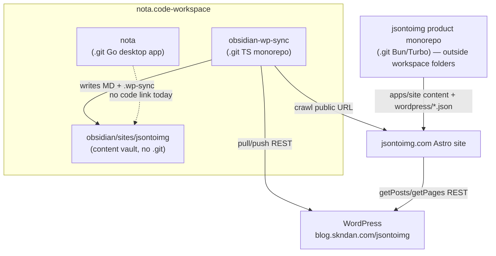
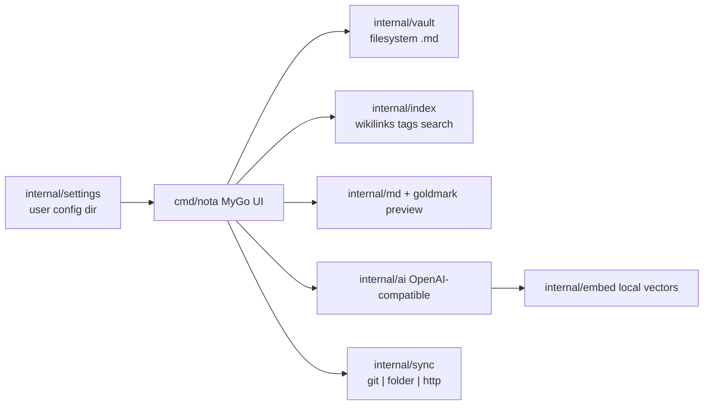

# Nota Repository Discovery and Architecture Audit

**Graft:** v0.30.1. Commands used: `map`, `ask --source`, `grep`, `skeleton`, `callers`. Nota and obsidian-wp-sync indexes were healthy. The content vault under `obsidian/sites/jsontoimg` has no meaningful code graph (Markdown-only); inspection was filesystem + frontmatter based.

**Assumption (verified):** The Cursor workspace folder labeled `jsontoimg` is the **Obsidian site content vault** at [`obsidian/sites/jsontoimg`](file:///Users/equitasrmb/Documents/skndan/obsidian/sites/jsontoimg), not the product monorepo. The live site/app lives in a **fourth sibling repo**: [`/Users/equitasrmb/Documents/skndan/jsontoimg`](file:///Users/equitasrmb/Documents/skndan/jsontoimg).

---

## A. Executive summary

The three workspace projects are **separate git roots** (plus one non-git vault folder), not a monorepo. They solve different problems and are only loosely coupled by convention and shared paths.

| Piece | What it actually is today |
|---|---|
| **Nota** | Small offline Go + MyGo desktop Markdown vault (Obsidian-like). Plain `.md` files, wikilinks/tags index, optional local AI (Ollama), git/folder/HTTP file sync. **No WordPress, SEO, keywords, sites, or product MCP.** |
| **obsidian-wp-sync** | The real multi-site WordPress ↔ Markdown system: TypeScript core + CLI + Obsidian plugin + Python crawl4ai bootstrap. Frontmatter content model, pull/push, media registry, validator. |
| **obsidian/sites/jsontoimg** | SEO/content working vault for one site: WP-synced `pages/`+`pillars/`, crawled `static/`, manual `keywords/`, sync state in `.wp-sync/`. |
| **jsontoimg (sibling monorepo)** | Bun/Turbo product: Next app, Astro marketing site, workers, WP JSON snapshots. Astro **fetches WordPress over REST** for blog/comparisons/etc.; docs are local Astro content collections. |

**Why content became chaotic:** the same logical articles exist as (1) live WordPress HTML, (2) vault Markdown from WP pull, (3) vault Markdown from public-site crawl (often different slugs/URLs), (4) Astro-rendered HTML from live WP, (5) optional `wordpress/*.json` snapshots, (6) parallel Astro docs MD that overlap crawled `static/docs`. Inventory tries to separate `wordpress` vs `static`, but crawl still materializes near-duplicates of WP posts under different paths. Keyword planning lives in CSV/Markdown **outside** note frontmatter, so targeting is not enforced by the sync engine.

**Fit for SEO CMS direction:** Nota’s Markdown vault core can remain the file layer, but sites/publish/SEO/analytics are **new product layers** (not present today). The reusable foundation for Scenario B (WordPress-backed sites) is almost entirely in **obsidian-wp-sync `packages/core`**, not Nota; the Obsidian plugin is optional UI that spawns the CLI. Scenario A (crawl-only sites) partially exists as bootstrap/crawler. SEO keywords, GSC, SerpApi, briefs, and performance history are **outside** both apps (manual vault files + Cursor-level GSC MCP).

---

## B. Workspace and project map

**Verified layout** ([`nota.code-workspace`](file:///Users/equitasrmb/Documents/skndan/nota.code-workspace)):

- Sibling dirs under `/Users/equitasrmb/Documents/skndan/`: `nota`, `obsidian-wp-sync`, `obsidian/`, `jsontoimg`, `nota-vault`
- Site registry: [`obsidian/.wp-sync/sites.json`](file:///Users/equitasrmb/Documents/skndan/obsidian/.wp-sync/sites.json) — one site `jsontoimg` → public `https://jsontoimg.com`, WP API `https://blog.skndan.com/jsontoimg`

**Stacks:**

- **Nota:** Go 1.27, MyGo UI, goldmark, fsnotify; binaries `cmd/nota`, preview `cmd/nota-kit`
- **obsidian-wp-sync:** npm workspaces — `packages/core`, `packages/cli`, `packages/obsidian-plugin`; Python `crawler/`
- **Vault:** Markdown + JSON inventories only
- **jsontoimg monorepo:** Bun workspaces `apps/{api,app,site,worker}`, Astro site, Docker, `wordpress/` snapshots

---

## C. Existing architecture (Nota)

**Content model:** independent Markdown documents on disk. Indexed frontmatter is Obsidian-like (`title`, `aliases`, `tags`) — not WP/SEO schema. Caches in `.app/` (`index.gob`, `embeddings.bin`).

**Capabilities present:** file tree, tabs, source/live/reading modes, quick open, full-text search, neighborhood graph from wikilinks, daily notes, templates, AI summarize/rewrite/continue/title-tags, “Ask the vault” via embeddings, sync with conflict copies (`ConflictName`).

**Absent in Nota code (graft grep over 51 files):** WordPress, SEO, keyword, MCP product integrations, multi-site, auth/users DB, queues, SerpApi, GSC. [`.mcp.json`](file:///Users/equitasrmb/Documents/skndan/nota/.mcp.json) only registers **graft MCP** for agents—not an in-app MCP host.

**Persistence:** files + local settings; no application database.

**Tests:** substantial Go unit tests under `internal/*_test.go` and `cmd/*_test.go`.

---

## D. Content ingestion and synchronization audit

### WordPress path (obsidian-wp-sync)

1. **Register site** → [`packages/core/src/sites/registry.ts`](file:///Users/equitasrmb/Documents/skndan/obsidian-wp-sync/packages/core/src/sites/registry.ts); public metadata in vault `.wp-sync/sites.json`; credentials in Obsidian plugin `data.json` / CLI env.
2. **Bootstrap** → [`runBootstrap`](file:///Users/equitasrmb/Documents/skndan/obsidian-wp-sync/packages/core/src/bootstrap/runBootstrap.ts:L105-L187): crawl public site (Python crawl4ai) → `crawl-snapshot.json`; fetch WP posts/pages/categories; [`reconcileSite`](file:///Users/equitasrmb/Documents/skndan/obsidian-wp-sync/packages/core/src/reconciler/siteReconciler.ts:L384-L634) writes inventory + scaffold notes; claims crawl paths that match WP slugs so remaining URLs become `static/`.
3. **Pull** → [`pullFromWordPress`](file:///Users/equitasrmb/Documents/skndan/obsidian-wp-sync/packages/core/src/sync/wpSyncEngine.ts:L150-L302): list posts/pages/categories/media; HTML→MD; write `pillars/<cat>/…` and `pages/…`; archive local WP notes whose `wp_id` disappeared remotely.
4. **Push** → [`pushToWordPress`](file:///Users/equitasrmb/Documents/skndan/obsidian-wp-sync/packages/core/src/sync/wpSyncEngine.ts:L350-L467): validate → upload media → MD→HTML → `upsertPost`/`upsertPage` via POST; never DELETE ([`assertNoDeleteMethods`](file:///Users/equitasrmb/Documents/skndan/obsidian-wp-sync/packages/core/src/wp/wpRestClient.ts:L200-L207); `HttpMethod = 'GET' | 'POST'`).
5. **Auth:** Basic auth username + Application Password ([`basicAuthHeader`](file:///Users/equitasrmb/Documents/skndan/obsidian-wp-sync/packages/core/src/wp/wpRestClient.ts:L24-L27)).

### Live site path (jsontoimg Astro)

[`apps/site/src/lib/wordpress.ts`](file:///Users/equitasrmb/Documents/skndan/jsontoimg/apps/site/src/lib/wordpress.ts) defaults to `https://blog.skndan.com/jsontoimg/wp-json/wp/v2`. Blog, comparisons, alternatives, use-cases, legal pages import from that client and `set:html` WP HTML. Docs use Astro collections from [`apps/site/src/content/docs`](file:///Users/equitasrmb/Documents/skndan/jsontoimg/apps/site/src/content/docs).

### Snapshot / import path

[`scripts/wordpress-import.ts`](file:///Users/equitasrmb/Documents/skndan/jsontoimg/scripts/wordpress-import.ts) + [`wordpress/posts.json|pages.json`](file:///Users/equitasrmb/Documents/skndan/jsontoimg/wordpress) — Application Password upsert by slug; parallel authoring channel to the Obsidian plugin.

### Nota sync

Unrelated to WP: git / folder / HTTP vault file sync with conflict-renamed files ([`internal/sync`](file:///Users/equitasrmb/Documents/skndan/nota/internal/sync)).

---

## E. Duplication and source-of-truth analysis

**Concrete example — “first API call” article:**

| Representation | Path / ID | Identity |
|---|---|---|
| WordPress post | `wp_id` 91, slug `getting-started-with-jsontoimg` | Live CMS |
| Vault WP Markdown | [`pillars/architecture/getting-started-with-jsontoimg.md`](file:///Users/equitasrmb/Documents/skndan/obsidian/sites/jsontoimg/pillars/architecture/getting-started-with-jsontoimg.md) | `source: wordpress`, `url_path: /blog/getting-started-with-jsontoimg` |
| Vault crawl Markdown | [`static/blog/getting-started-with-jsontoimg-first-api-call/index.md`](file:///Users/equitasrmb/Documents/skndan/obsidian/sites/jsontoimg/static/blog/getting-started-with-jsontoimg-first-api-call/index.md) | `source: static`, **different slug/url_path** |
| Archived duplicate | [`_archive/duplicate-static/...`](file:///Users/equitasrmb/Documents/skndan/obsidian/sites/jsontoimg/_archive/duplicate-static) | Prior crawl copies |
| Astro runtime | `apps/site/src/pages/blog/[slug].astro` + WP REST | Same WP post, HTML at build/request time |
| Snapshot | `wordpress/posts.json` id 91 | Offline dump |

Bodies are near-duplicates (~14.5k chars) but not identical (static includes crawl chrome: skip links, “Published…”). Active `pillars`/`pages`/`static` have **no colliding `url_path` among themselves** (reconciler claims WP paths); the live near-duplicate uses a **different** public path (`/blog/getting-started-with-jsontoimg` vs `/blog/getting-started-with-jsontoimg-first-api-call`). Historical same-`url_path` copies live under `_archive/duplicate-static/` (~43 overlapping paths with live notes). Docs: ~46–48 parallel paths between vault `static/docs` and `apps/site/src/content/docs` with **0 identical bodies**.

**Counts (vault, excluding `_archive`/`.wp-sync`):** ~67 `source: wordpress`, ~81 `source: static`, 67 `wp_id`s; inventory JSON: 67 wordpress + 84 static.

**Astro note:** `apps/app` (Next) is product-only (`robots` disallow all). Marketing is Astro `apps/site`. `apps/site/README.md` still claims some WP routes live in `src/content` — **stale**; code is WP REST. Monorepo `seo:check` (`scripts/seo-sitemap.ts`) validates URL coverage only; it does **not** enforce `wordpress/content-plan.json` keywords.

| Content or functionality | Current location | Duplicate location | Problem | Evidence |
|---|---|---|---|---|
| Blog/marketing HTML | WordPress CMS | Astro `set:html` from WP REST | Two consumers; vault MD is a third | `apps/site/src/lib/wordpress.ts`, blog `[slug].astro` |
| Same article as MD | `pillars/.../getting-started-with-jsontoimg.md` | `static/blog/...-first-api-call/index.md` | Dual MD; different slugs; unclear edit target | Frontmatter `wp_id: 91` vs `source: static`; inventory rows |
| Docs MD | `apps/site/src/content/docs/*.md` | `static/docs/**/index.md` | Parallel docs trees; crawl vs hand-authored Astro | `mcp.md` vs `static/docs/mcp/index.md` differ |
| WP dump | Live WP | `jsontoimg/wordpress/*.json` | Third serialization; import script can race plugin push | `wordpress-import.ts` |
| Keyword→page map | `keywords/keyword-page-map.md` + CSV | Not in note frontmatter | Planning not bound to documents | CSV columns `Existing Target URL`; notes lack keyword fields |
| Pillar concept | WP category→folder heuristic in sync | SEO `keywords/` + `pillars/` topic planning | Same word, different meanings | `reconcileSite` pillar = category slug; keyword docs are manual |
| WP sync engine | obsidian-wp-sync core | Nota `internal/sync` | Unrelated sync; easy to confuse | No WP symbols in Nota |
| Featured images | WP media + vault registry | Remote URLs still in some page bodies | Incomplete local media binding | pages still embed `blog.skndan.com/...` images; many `featured_image: null` |

**Propagation:** Push updates WP → Astro reads WP (propagates). Pull overwrites vault WP notes from WP. Static crawl notes **do not** push and **do not** update when WP changes unless re-bootstrap/crawl. No link entity tying static crawl ↔ `wp_id`.

**Conflict detection:** `last_synced_hash` is **written** on pull/push but **never read** to skip or detect divergence (`contentHash` callers only assign). Pull always rewrites; push always upserts. Nota’s conflict copies apply only to its own file sync.

---

## F. Feature capability matrix

| Capability | Status | Evidence |
|---|---|---|
| Site onboarding (multi-site registry) | **Implemented** in wp-sync; **Not** in Nota | `sites.json`, AddSiteModal, CLI `sites add` |
| Scenario A: crawl public site → MD | **Partially** (bootstrap + static notes; no Nota UX; static never auto-publishes) | `runBootstrap`, crawler, `source: static` |
| Scenario B: WP REST import | **Implemented** in wp-sync | `pullFromWordPress`, Application Password |
| Markdown vault editing | **Implemented** in Nota + Obsidian (external) | Nota vault; vault files |
| Bidirectional WP sync | **Partial** (pull+push; no conflict/merge; no delete) | `pushToWordPress`, `assertNoDeleteMethods` |
| Preserve WP id/slug/status | **Implemented** in frontmatter | `VaultNoteFrontmatterSchema` |
| Preserve WP modified timestamps | **Not implemented** as persisted vault fields | `modified_gmt` on types; not in frontmatter schema |
| Categories | **Partial** (primary category slug; tags always `[]` on pull) | pull sets `tags: []`; `listTags` has no callers |
| Featured images / media | **Partial** (download/registry/upload; featured often null; placeholders blocked) | media registry + validator |
| SEO plugin meta (Yoast/RankMath) | **Not implemented** | graft: no yoast/rank_math/meta_description fields |
| Keyword inventory / assignment | **Partial outside apps** (manual CSV/MD in vault) | `keywords/keyword-master-database.csv` |
| Topic pillars/clusters (SEO) | **Partial / overloaded** (folder roles from WP categories ≠ keyword strategy) | frontmatter `role: pillar|cluster` |
| Internal link graph | **Partial** (Nota wikilink graph; wp-sync rewrites wikilinks→URLs on push; no suggested vs existing) | Nota `graphPane`; `rewriteWikilinksToUrls` |
| On-page SEO fields | **Not implemented** as model (title/slug/status only) | schema lacks seo_title, meta_description, canonical |
| GSC integration | **Not in Nota/wp-sync**; **Available** as Cursor MCP `user-gscServer` (authenticated) | MCP capabilities: queries, pages, CTR, position, compare periods |
| SerpApi | **Not implemented** in these repos | no code hits |
| MCP in Nota product | **Not implemented** (only graft for agents) | `.mcp.json` |
| AI content ops | **Partial** in Nota (note rewrite/summarize/ask); **Not** SEO briefs/GSC-driven | `internal/ai`, `aiPane` |
| Multi-site isolation | **Implemented** in wp-sync paths `sites/<id>/`; Nota is single vault root | `sitePath`, Nota `openVault` |
| Auth/users for Nota SaaS | **Not implemented** | local settings only |

---

## G. Existing data model analysis

**obsidian-wp-sync note identity** ([`frontmatter.ts`](file:///Users/equitasrmb/Documents/skndan/obsidian-wp-sync/packages/core/src/schema/frontmatter.ts)):

`title`, `source` ∈ {wordpress, static}, `role` ∈ {pillar, cluster, page, static}, `wp_id`, `wp_type`, `slug`, `url_path`, `status`, `pillar`, `categories[]`, `tags[]`, `featured_image`, `last_synced_hash`.

**Site:** id, name, publicSiteUrl, wpApiUrl (no password in git).

**Media:** SHA-256 registry mapping vault path ↔ wpMediaId.

**Inventory:** wordpress[] + static[] with vault_path, url_path, wp_id.

**Nota:** path-keyed notes; index of links/tags; embedding chunks; no site/source entity.

**Keyword planning (vault only):** CSV rows with Cluster, Primary/Secondary, Intent, GSC metrics, Existing Target URL, Opportunity Score — **not** schema-linked to `wp_id` or note paths.

**Missing for target product entities:** first-class Website, ContentSource, LogicalContentItem spanning representations, Keyword entity, KeywordAssignment, InternalLink edge store, SEOAudit, SERPObservation, GSCObservation time series, SyncRevision/conflict records.

---

## H. Target product architecture assessment

**Strengths to reuse**

- Multi-site vault layout + WP REST client + MD↔HTML + media registry + validator + crawl bootstrap (`packages/core` is the reusable library; Obsidian plugin is a thin CLI spawner).
- Astro already treats WP as runtime source for marketing HTML — good pattern for “one logical WP entity, many presentations.”
- Manual keyword CSV shows the *desired* traceability fields (primary/secondary, GSC, target URL); needs to become structured data.

**Constraints**

- Nota’s architecture is a **local single-vault editor**, not a multi-tenant SEO platform. Using Nota as the UX shell would mean embedding or calling wp-sync core and inventing SEO entities—not extending existing Nota domain types.
- `role: pillar/cluster` today means WP category folder layout, not SEO topic architecture.
- Static crawl notes are a second corpus that looks like content but must not be pushed; easy to edit the wrong file.
- Dual write paths to WP (plugin push vs `wordpress-import.ts`) risk overwrites.

**Likely redesign areas (assessment only):** logical content identity across WP/static/Astro; conflict-aware sync using hashes/remote `modified`; keyword/assignment/performance schema; on-page SEO + plugin meta; GSC/SERP ingestion; replacing Obsidian dependency if Nota becomes the editor.

---

## I. Integration readiness

| Integration | Readiness |
|---|---|
| **WordPress REST** | Ready in wp-sync core; Nota can call the same REST API **without** the Obsidian plugin (CLI already does). Need HTTPS, Application Passwords, careful HTML round-trip. |
| **GSC MCP** | Ready at Cursor agent level (`user-gscServer`, authenticated): search analytics, page/query, period compare, URL inspection, sitemaps. **Not wired into Nota or vault schema.** Historical snapshots not persisted in-repo. |
| **SerpApi** | Missing; keyword CSV cites “SERP” as data source but no client. Volume/KD columns appear manually estimated. Additional providers still needed for true volume/KD if required. |
| **Other MCP** | jsontoimg product MCP is **image generation**, unrelated to SEO. Nota only has graft MCP for coding agents. |
| **AI content ops** | Nota’s Ollama/OpenAI client is reusable for text transforms; no brief/pillar/GSC tool loop. |

---

## J. Critical architectural risks

1. **Duplicate MD for one article** (WP note vs crawl static) with different URLs → wrong file edited; SEO drift.
2. **Unclear ownership:** WP vs Astro docs MD vs vault static vs JSON snapshots.
3. **Sync conflicts:** hash stored but unused; push can clobber remote edits; pull can clobber local edits.
4. **Metadata loss:** tags empty on pull; no SEO plugin fields; `modified` not in frontmatter; featured images often null.
5. **Broken keyword↔content binding:** CSV/maps not enforced on notes; competing URLs already noted in keyword docs.
6. **Taxonomy inconsistency:** WP categories vs SEO clusters vs folder names.
7. **Internal links:** wikilinks optional; crawl MD uses absolute public URLs; no graph of “existing vs suggested.”
8. **No SEO performance history store** (GSC only live via MCP).
9. **Credentials:** plugin `data.json` / `.env` / monorepo WP env — multiple secret surfaces.
10. **Multi-site:** wp-sync OK; Nota has no site isolation; opening whole `obsidian` vault mixes sites/keywords/graft caches.

---

## K. Unresolved decisions

**Confirmed technical facts**

- Four related trees: Nota app, wp-sync tooling, Obsidian content vault, jsontoimg product monorepo.
- Astro marketing content for blog/comparisons/etc. **derives from WordPress**, not from vault Markdown.
- Vault `static/` is crawl/manual and **never pushed** to WP.
- Nota has no WP/SEO domain.

**Product decisions not decidable from code alone**

- Should Nota **embed** wp-sync core, **replace** Obsidian as the editor, or remain a separate note app while SEO CMS is a new surface?
- Authoritative store for docs: Astro `src/content/docs` vs vault `static/docs` vs WP?
- Should crawl static copies of WP URLs be **references** only (no body), deleted, or diff tools?
- Where do keywords live long-term: vault files, Nota DB, or external?
- Is WordPress still the publish target for all marketing pages, or will Astro MD become primary for some routes?
- Single-user local-first vs multi-user cloud for the SEO platform?

---

## L. Evidence index

**Nota:** [`README.md`](file:///Users/equitasrmb/Documents/skndan/nota/README.md), [`go.mod`](file:///Users/equitasrmb/Documents/skndan/nota/go.mod), [`cmd/nota/app.go`](file:///Users/equitasrmb/Documents/skndan/nota/cmd/nota/app.go) `openVault`, [`internal/vault`](file:///Users/equitasrmb/Documents/skndan/nota/internal/vault), [`internal/index`](file:///Users/equitasrmb/Documents/skndan/nota/internal/index), [`internal/ai`](file:///Users/equitasrmb/Documents/skndan/nota/internal/ai), [`internal/sync`](file:///Users/equitasrmb/Documents/skndan/nota/internal/sync), [`.mcp.json`](file:///Users/equitasrmb/Documents/skndan/nota/.mcp.json)

**wp-sync:** [`README.md`](file:///Users/equitasrmb/Documents/skndan/obsidian-wp-sync/README.md), [`packages/core/src/schema/frontmatter.ts`](file:///Users/equitasrmb/Documents/skndan/obsidian-wp-sync/packages/core/src/schema/frontmatter.ts), [`wp/wpRestClient.ts`](file:///Users/equitasrmb/Documents/skndan/obsidian-wp-sync/packages/core/src/wp/wpRestClient.ts), [`sync/wpSyncEngine.ts`](file:///Users/equitasrmb/Documents/skndan/obsidian-wp-sync/packages/core/src/sync/wpSyncEngine.ts), [`reconciler/siteReconciler.ts`](file:///Users/equitasrmb/Documents/skndan/obsidian-wp-sync/packages/core/src/reconciler/siteReconciler.ts), [`bootstrap/runBootstrap.ts`](file:///Users/equitasrmb/Documents/skndan/obsidian-wp-sync/packages/core/src/bootstrap/runBootstrap.ts), [`validator/vaultValidator.ts`](file:///Users/equitasrmb/Documents/skndan/obsidian-wp-sync/packages/core/src/validator/vaultValidator.ts), plugin [`main.ts`](file:///Users/equitasrmb/Documents/skndan/obsidian-wp-sync/packages/obsidian-plugin/src/main.ts)

**Vault:** [`sites.json`](file:///Users/equitasrmb/Documents/skndan/obsidian/.wp-sync/sites.json), [`.wp-sync/site-inventory.json`](file:///Users/equitasrmb/Documents/skndan/obsidian/sites/jsontoimg/.wp-sync/site-inventory.json), `pages/`, `pillars/`, `static/`, `keywords/`, `_archive/duplicate-static/`

**jsontoimg monorepo:** [`apps/site/src/lib/wordpress.ts`](file:///Users/equitasrmb/Documents/skndan/jsontoimg/apps/site/src/lib/wordpress.ts), [`content.config.ts`](file:///Users/equitasrmb/Documents/skndan/jsontoimg/apps/site/src/content.config.ts), [`scripts/wordpress-import.ts`](file:///Users/equitasrmb/Documents/skndan/jsontoimg/scripts/wordpress-import.ts), `wordpress/posts.json`

**Graft orientation:** Nota map ~51 Go files; wp-sync map hubs in `packages/core` + Obsidian plugin.

---

## Follow-on

This discovery report is historical evidence. Product direction is locked in the decision log and backlog (including merge of wp-sync into Nota).

- Implementation backlog: [`../../../backlog.md`](../../../backlog.md)
- Locked decisions: [`2026-11-18-seo-cms-decisions.md`](2026-11-18-seo-cms-decisions.md)
- This document does not override the decision log where they disagree.
